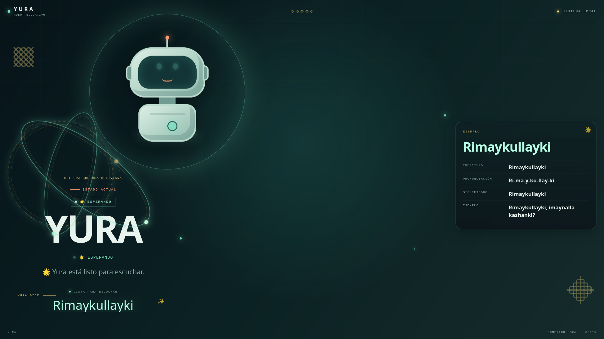
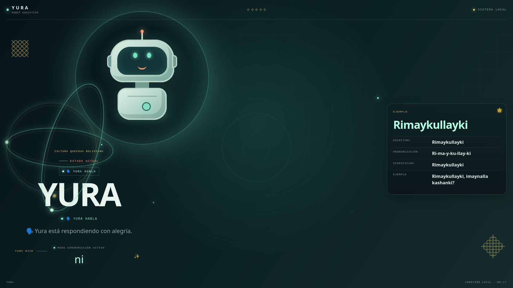
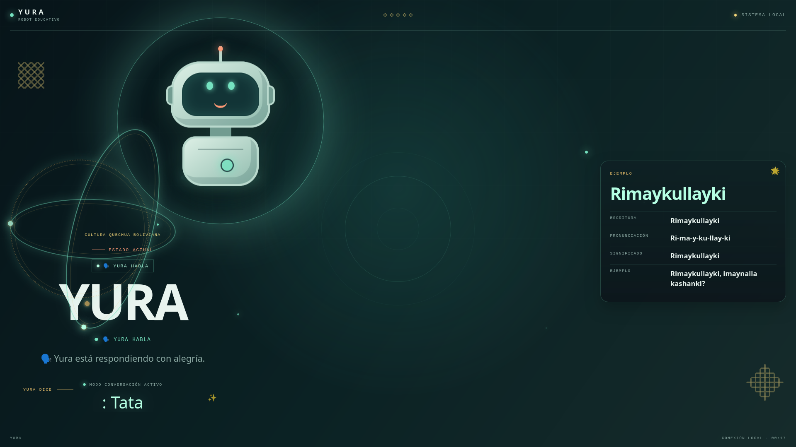
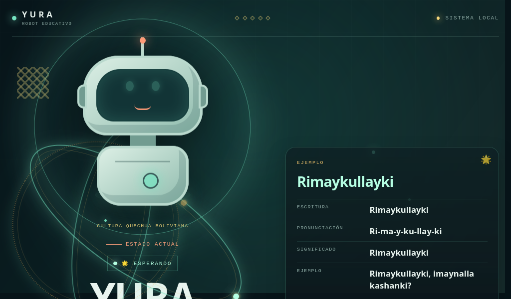
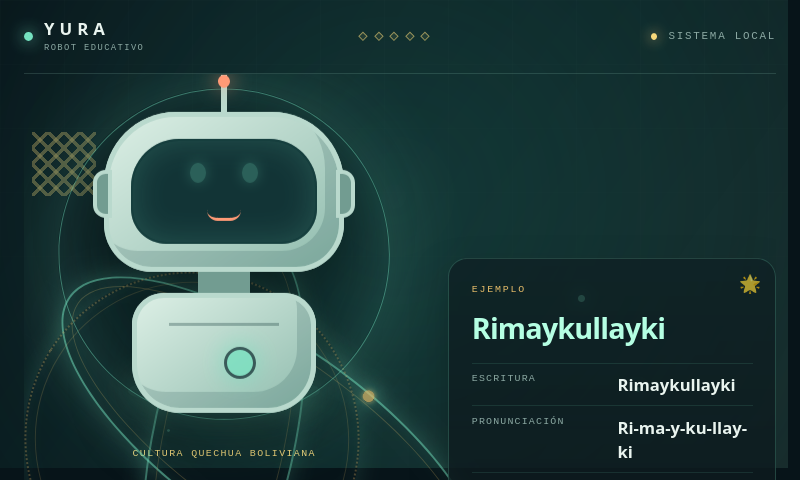
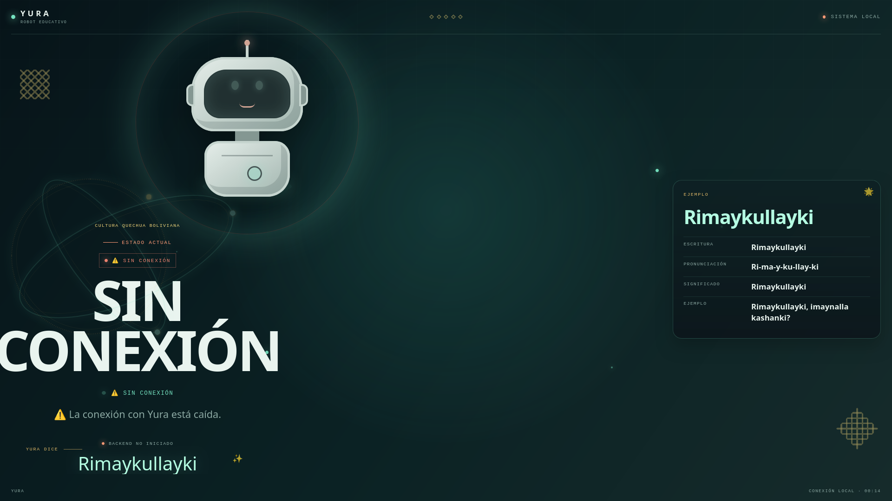
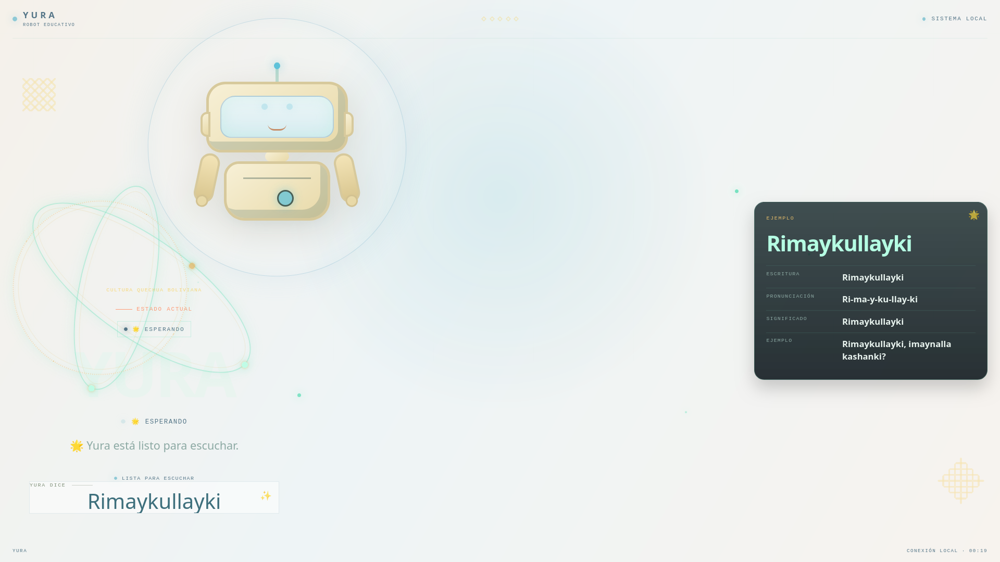

# Informe final de auditoría y pruebas del proyecto YURA

**Informe:** 001 · **Fecha:** 2026-09-27 · **Auditor final:** Subagente 7 (QA principal), que consolida el trabajo de los subagentes 1 a 6.

**Proyecto:** YURA, robot educativo para practicar quechua con estudiantes de sexto de primaria (Unidad Educativa Boliviano Holandés, Cochabamba).

**Documento de referencia (tesis):** "YURA Robot interactivo para la práctica y seguimiento del aprendizaje del quechua en estudiantes de sexto de primaria de la Unidad Educativa Boliviano Holandés", versión del 17/08/2026. Autores: Crespo Cordero Freddy Ademar, Jorge Guarachi Franklin Ronaldo y Mendieta Arnez Wilson. Tutor: M. Sc. Ing. Alánez Duran Joel Reynaldo. Instituto Técnico Nacional de Comercio "Federico Alvarez Plata" Nocturno, carrera de Sistemas Informáticos.

**Leyenda de estados:** 🟢 APROBADO · 🟡 OBSERVACIÓN · 🟠 REQUIERE CORRECCIÓN · 🔴 ERROR CRÍTICO · ⚫ NO VERIFICADO.

**Prioridades:** CRÍTICO · ALTO · MEDIO · BAJO.

# 0. Alcance, método y limitaciones

## 0.1 Qué se auditó

- **Cerebro del robot (Python):** `/home/yura/Proyecto Yura /cerebro_yura`. Es el commit `aac001b` más los cambios de hoy, que aún no tienen commit. Incluye los módulos `main_robot.py`, `conversacion.py`, `traductor.py`, `juego.py`, `audio_manager.py`, `gemini_transcriber.py` y `web/app.py`, la pantalla web (`index.html`, `app.js`, `style.css`, `style-draft.css`), las pruebas `tests/`, los scripts de despliegue `scripts/` y la base de datos `diccionario.db`.
- **Plataforma web Laravel:** repositorio público MENARWIL/yura-platform, commit `d419bd0`. Solo se hizo revisión estática sobre una copia de solo lectura.
- **Documento de tesis:** PDF de 63 páginas. Se revisaron sobre todo los objetivos, alcances, límites, requisitos RF y RNF, UML, despliegue, resultados, conclusiones y anexos.
- **Contenido quechua:** las 187 filas de la base de datos y todo el quechua que está escrito en el código, las tarjetas y los *prompts*.

## 0.2 Método

- Se usaron **7 subagentes**, cada uno con un informe propio en `documentacion_pruebas/informes_subagentes/`:
  - 1: base de datos y quechua.
  - 2: frontend.
  - 3: backend y seguridad.
  - 4: integración.
  - 5: casos extremos.
  - 6: trazabilidad.
  - 7: este informe, que consolida, resuelve contradicciones y hace la regresión.
- **Reglas comunes:**
  - Solo lectura sobre el proyecto.
  - La base de datos se abrió siempre con `?mode=ro`.
  - No se mostró ninguna clave.
  - No se corrigió nada.
  - No se inventó quechua.
  - Máximo 25 llamadas a servicios en línea por subagente.
- **Regla central: "no aprobar por suposición".** Todo lo que no se ejecutó o midió figura como ⚫ NO VERIFICADO. No se usan expresiones como "parece funcionar" ni "debería funcionar".
- **Criterio lingüístico:** quechua boliviano de Cochabamba, alfabeto normalizado de tres vocales. Ninguna forma quechua de este informe es una corrección: cualquier alternativa es una **forma sugerida para validar con un hablante**.
- **Qué hizo el subagente 7:**
  - Volvió a ejecutar `pytest`.
  - Reprodujo con scripts propios las cifras que no coincidían entre subagentes.
  - Verificó los cambios de hoy uno por uno.
  - Sus evidencias están en `evidencias/07_*.txt`.

## 0.3 Qué no se pudo ejecutar o verificar

- **Plataforma Laravel:** en esta computadora no hay PHP, Composer ni MySQL. Todo su comportamiento en ejecución es ⚫ NO VERIFICADO; sus hallazgos proceden de leer el código.
- **App Android para padres:** no existe ni código ni APK en ningún repositorio ni en el disco. ⚫
- **ESP32, motores, sensores y pantalla táctil de 7":** no existen físicamente en este equipo (`lsusb`, `/dev/tty*` y `/proc/bus/input`). ⚫ o 🔴 según lo que afirma la tesis.
- **Voz real de niños en el aula:** no se probó. Las pruebas de voz usaron voz sintética es-MX.
- **Precisión de Gemini:** no se pudo medir porque la cuota gratuita estaba agotada.
- **Latencia de extremo a extremo con micrófono real:** no medida.
- **Firewall (`ufw`):** no se revisó porque requiere root.
- **Lector de pantalla real:** no probado.

## 0.4 Aviso sobre un error del propio proceso de auditoría

Durante la revisión inicial de hoy, el asistente afirmó que `main_robot.py` no llamaba a `loop_principal()` en `__main__`. **Esa afirmación era falsa.** La llamada existía, pero el archivo no terminaba en salto de línea y la lectura la cortó. Al "corregirlo" se añadió una **segunda** llamada.

Este informe lo registra como **regresión introducida hoy** (sección 15, problema P-30) y demuestra su efecto con una simulación.

# 1. Resumen ejecutivo

**Veredicto: el proyecto NO está listo para presentarse como está.**

- **Lo que funciona:** hay un asistente de voz de software que, en un PC de escritorio:
  - arranca en 4 s;
  - escucha por un micrófono USB;
  - transcribe con Whisper local (Gemini está sin cuota);
  - traduce palabras con un diccionario SQLite;
  - conversa con un LLM (Groq);
  - habla por el televisor mediante HDMI;
  - muestra su estado en una pantalla web.

  La suite de pruebas pasa entera: **28/28** (verificado hoy).
- **Lo que no funciona es de fondo:**
  - enseña contenido quechua equivocado;
  - la pantalla deforma lo que enseña;
  - la evaluación de las respuestas no es fiable;
  - una frase inocente apaga el robot;
  - no existe nada de lo que la tesis promete sobre hardware, app móvil, registro de intentos e integración con la plataforma.

**Hallazgos principales (todos verificados salvo que se indique lo contrario):**

1. 🔴 **Contenido quechua.** De 187 filas, solo 103 (55 %) son correctas o coherentes. 26 son posibles errores de significado que YURA **dice en voz alta**. Ejemplos:
   - agua = *Uma* (en quechua *uma* es "cabeza");
   - escuela = *T'anta wasi* ("casa del pan");
   - nariz = *Sunkha*;
   - mano = *Mak'a*;
   - abeja = *Wanak'u*.

   El juego pregunta "agua" y da *Uma* como respuesta correcta.
2. 🔴 **La pantalla muestra texto educativo cortado o equivocado:**
   - "Tata significa papá" aparece como **"pap"**;
   - "Wawa significa niño" aparece como **"ni"**;
   - una ambigüedad papa/papá aparece solo como "Papa".
3. 🔴 **Cualquier frase del menú que contenga «apagar»** ("no quiero apagar", "¿cómo se dice apagar la luz?") apaga el robot y cierra el servidor web. Hace falta reiniciarlo a mano.
4. 🟠 **El evaluador del juego y de la práctica** acepta **143 pares de palabras quechuas distintas** como si fueran la misma (Tawa/Wawa, Asnu/Vasu, Sara/Sach'a…). Además felicita aunque haya 0 de 4 aciertos.
5. 🟠 **La normalización de texto borra la ñ y el apóstrofo:**
   - el modo traductor no encuentra "niño", "montaña" ni "pequeño";
   - "¿qué significa…?" falla en 42 filas.
6. 🔴 **Tesis frente a realidad.** De 95 requisitos o promesas del documento:
   - solo **3 (3,2 %)** se cumplen y están verificados;
   - **27 (28,4 %)** no están implementados o están contradichos;
   - **19 (20 %)** no tienen evidencia.

   Los 8 requisitos formales RF y RNF: **0 cumplidos**. No existen ESP32, pantalla táctil, Faster-Whisper, SciPy, APK, tabla `phonetic_evaluations` ni conexión robot↔plataforma. Las cifras de resultados (87,4 %, 77 apoderados, de 2 a 9 interacciones) no tienen ningún respaldo técnico.
7. 🔴 **Privacidad de menores:**
   - la voz de los niños va a Google (Gemini), el texto a Groq y la voz de YURA a Microsoft, sin aviso;
   - el modo SILENCIO **sigue grabando** y enviando a la nube lo que se dice en el aula.
8. 🟠 **Robustez:**
   - una base de datos bloqueada o dañada mata el hilo del robot, pero la pantalla sigue diciendo "activo";
   - con la red colgada, Groq bloquea el robot más de 100 s;
   - Gemini tiene una cuota gratuita de 20 peticiones al día.

**Cifras de la auditoría:**

- **548 pruebas ejecutadas:** 🟢 268 · 🟡 105 · 🟠 138 · 🔴 33 · ⚫ 4.
- **Además:** 95 requisitos trazados y 10 trazas de contenido.
- **52 problemas consolidados, sin duplicados:** 8 CRÍTICOS, 17 ALTOS, 16 MEDIOS y 11 BAJOS.
- **pytest:** 28 passed.
- **Regresión de hoy:** 1 regresión confirmada (doble `loop_principal`). El resto de cambios cumple lo que prometía, con efectos secundarios documentados.

# 2. Descripción del proyecto

**Lo que promete la tesis.** YURA sería un robot educativo físico con estos componentes:

- ESP32 con motores, servos y sensores.
- Pantalla LCD táctil de 7", micrófono y altavoces.
- Una mini PC con Debian 13 y Faster-Whisper, que evaluaría la pronunciación en quechua con un "porcentaje de precisión fonética".
- Registro de cada intento en la tabla `phonetic_evaluations`.
- Envío de los resultados a una plataforma web Laravel/MySQL para docentes.
- Una app Android que notificaría a los padres en tiempo real.
- Actividades grupales con puntajes.

La tesis también fija límites. El más relevante: **"no implementará conversaciones libres mediante IA"**.

**Lo que existe realmente.** Dos piezas de software separadas:

1. **Cerebro Python** (este repositorio, 1 commit). Es un asistente de voz con los modos MENÚ, CONVERSAR, JUEGO, TRADUCIR, SILENCIO y SALIR, que se maneja solo por voz. Su pantalla web solo muestra el estado. No tiene botones.
2. **Plataforma Laravel** (otro repositorio). Hace gestión académica: estudiantes, docentes, notas, exportaciones y un endpoint para el robot que nadie llama.

**Hardware real:**

| Componente | Real |
|---|---|
| Procesador y memoria | PC i3-10100, 16 GB de RAM |
| GPU | GTX 1650 |
| Sistema operativo | Ubuntu 24.04 |
| Micrófono | audífonos USB C-Media |
| Salida de voz | televisor por HDMI |
| Actuadores | ninguno: `mover_actuador` solo imprime texto |

# 3. Arquitectura encontrada

## 3.1 Componentes del cerebro (verificado)

| Componente | Archivo | Tecnología | Observación |
|---|---|---|---|
| Servidor y pantalla | `web/app.py` | Flask en 0.0.0.0:5000 | Rutas `GET /`, `/api/status` y `/api/card`; sondeo cada 5 s |
| Orquestador | `main_robot.py` | `BrainYura` con máquina de estados | 877 SLOC; `hablar` con complejidad E (35) |
| Escucha | `audio_manager.py` | sounddevice, VAD propio | Umbral de energía adaptativo; no usa SciPy |
| Transcripción principal | `gemini_transcriber.py` | Google Gemini `gemini-3.8-flash` (nube) | Cuota gratuita de 20 peticiones al día |
| Transcripción de respaldo | `main_robot.py:417` | openai-whisper "base" en GPU, `language="es"` | Acertó 8/8 frases sintéticas |
| Reconocedor Vosk | `main_robot.py:446-456` | Vosk (58 MB) | Se carga y **no se usa** |
| Conversación | `conversacion.py` | Groq `openai/gpt-oss-120b` (nube) | Contradice el límite 5.4 de la tesis |
| Traducción | `traductor.py` | SQLite (15 tablas, 187 filas) + Groq | Búsqueda por subcadena |
| Juego | `juego.py` | 6 palabras fijas en el código | Evaluación por similitud de texto |
| Voz | `main_robot.py:205-380` | Edge TTS (nube) + ffmpeg + pw-play | Respaldo `spd-say` |

## 3.2 Flujo real de un turno

1. Micrófono USB.
2. `grabar_hasta_silencio`: 0,7 s de preparación y 1,0 s de silencio final.
3. Transcripción: Gemini (si responde) o Whisper.
4. `_normalizar_texto`, que pierde ñ y apóstrofo.
5. Decisión por subcadenas en el estado actual.
6. BD local o Groq.
7. Voz: Edge TTS → ffmpeg → pw-play (HDMI).
8. `_set_web_status`.
9. Pantalla: `app.js` extrae la palabra con una expresión regular.

**Hilos:**

- `loop_principal` corre en el hilo daemon `yura-backend`.
- Flask atiende en otros hilos.
- Hay dos conexiones SQLite de lectura y escritura, aunque el cerebro nunca escribe.

## 3.3 Relación con la plataforma y con la tesis

- **Diagrama de despliegue de la tesis** (pdf 58): ESP32 (Serial USB) ↔ cerebro Debian/Faster-Whisper ↔ (WiFi/REST) ↔ Laravel/MySQL ↔ app Android.
- **Realidad:**
  - **no hay ESP32**;
  - **no hay cliente REST** en el cerebro;
  - **no hay app**;
  - el ASR es Gemini más openai-whisper.
- El endpoint `POST /api/v1/robot/activity` existe en Laravel, pero **nadie lo llama**.

# 4. Auditoría de base de datos

Fuente: `01_bd_quechua.md`. Verificación del subagente 7: 187 filas contadas hoy en modo `ro`.

## 4.1 Estructura

| Aspecto | Resultado | Estado |
|---|---|---|
| Tablas y filas | 15 tablas `nivelN_categoria`, 187 filas | 🟢 |
| Integridad física | `integrity_check = ok`, UTF-8, NFC | 🟢 |
| Esquema | 4 tablas sin `significado` (45 filas); `nivel1_numeros` sin AUTOINCREMENT | 🟠 |
| Índices y restricciones | Ninguno: sin índices, UNIQUE ni FK | 🟡 |
| Duplicados de quechua | 5 grupos (Uma, K'anchay, Tata, Huk, K'uchu) + 2 colisiones sin apóstrofo | 🟠 |
| Huecos de ID | `nivel1_colores` sin los id 3, 5, 6, 7, 9 y 11 | 🟡 |
| Columna `pronunciacion` | 187 rutas `C:/audios/...`; 0 existen; ningún código la usa | 🟠 |
| Versionado | `*.db` ignorado por Git; sin script de semilla | 🟠 |
| Apertura | RW en `main_robot.py:577` y `conversacion.py:182` aunque solo lee | 🟡 |
| Rendimiento | Unos 1 ms por búsqueda con 187 filas; 0,18 s con 50.187 filas | 🟢 hoy / 🟡 no escala |

## 4.2 Cambio de hoy frente al respaldo

`diccionario.respaldo.db` solo difiere en 2 filas:

- `nivel1_familia` id 1: Tayta pasa a **Tata** (Padre).
- Nueva fila id 7: **Tata** = Papá.

Coincide con lo declarado. Consecuencia: se crea un duplicado exacto (mismo quechua y mismo audio) y una ambigüedad "papa/papá" que el traductor resuelve bien en voz, pero que la pantalla muestra mal (ver 7 y 11).

## 4.3 Robustez de la BD (subagente 5)

| Situación | Resultado | Estado |
|---|---|---|
| BD ausente | Avisa y no crea el archivo | 🟢 |
| BD de 0 bytes | "[OK] enlazada" y responde "No estoy seguro…" a todo | 🟠 |
| BD con texto plano | `DatabaseError` no capturado; el hilo del robot muere | 🟠 |
| BD bloqueada | `OperationalError` tras 5 s, no capturado | 🟠 |
| Filas NULL | Se envía `Casa = None` a Groq como "vocabulario verificado" | 🟠 |
| Inyección SQL | Sin efecto: los nombres de tabla se validan y se citan | 🟢 |

# 5. Auditoría del contenido quechua

Fuente: `01_bd_quechua.md` §6-7. Criterio: quechua boliviano de Cochabamba, alfabeto de 3 vocales. **Toda forma alternativa que aparece aquí es una forma sugerida para validar con un hablante, no una corrección.**

## 5.1 Recuento de las 187 filas

| Estado lingüístico | Filas | % |
|---|---|---|
| Correcto / coherente | 103 | 55 % |
| Requiere revisión de hablante | 32 | 17 % |
| Posible error de significado | 26 | 14 % |
| Inconsistente (grafía e/o, categoría) | 14 | 7 % |
| No verificado | 9 | 5 % |
| Duplicado | 3 | 2 % |

## 5.2 Posibles errores de alta confianza que YURA enseña

| Español | En la BD | Observación del subagente 1 | Estado |
|---|---|---|---|
| Agua | Uma | *uma* = cabeza en quechua; "agua" en aimara. El propio código usa *yaku* | 🔴 |
| Escuela | T'anta wasi | Literal "casa del pan" | 🔴 |
| Nariz | Sunkha | *sunkha* = barba | 🔴 |
| Diente | K'aki | *k'aki* = mentón | 🔴 |
| Espalda / Mesa | K'uchu | *k'uchu* = rincón | 🔴 |
| Mano | Mak'a | La misma tabla usa *maki* en "Ruku maki" | 🔴 |
| Hueso | K'ullu | *k'ullu* = madera | 🔴 |
| Caliente | Q'uychi | Se asocia con arcoíris | 🟠 |
| Venado | Sacha | Se asocia con árbol o monte | 🔴 |
| Abeja | Wanak'u | Se asocia con guanaco | 🔴 |
| Avispa | Ch'iwchi | Se asocia con pollito | 🟠 |
| Dieciocho | Chunka pusqayuq | Rompe el patrón de la propia tabla (*pusaq*) | 🟠 |
| Aquí / Ahora | Kay | *kay* = este / esta | 🟠 |

La lista completa de las 26 filas y de las 32 que requieren revisión está en `01_bd_quechua.md` §6.1.

## 5.3 Incoherencias entre la BD y el código

| Concepto | BD | Código, tarjeta o *prompt* |
|---|---|---|
| Agua | Uma | yaku (`juego.py:107`, `gemini_transcriber.py:276`, `main_robot.py:833`) |
| Buenos días | Allin punchay | Allin p'unchay (`conversacion.py:26`, tarjeta, *prompts*) |
| ¿Cómo estás? | Imaynalla | kachkanki (conversación) y kashanki (`web/app.py:22`, `app.js:21`) |
| Perro | Allqo | allqu (`juego.py:105`) |
| Gato | Misi | michi (`juego.py:104`) |
| Árbol | Sach'a | sacha (`juego.py:109`); en la BD *Sacha* = venado |

**Otros problemas del contenido:**

- **Grafía mezclada:** 14 filas usan e/o (Q'ello, Q'omer, Qocha, Soqta, Sonqo, Allqo…) mientras otras usan la norma de 3 vocales (Urqu, Isqun).
- **Préstamos sin política definida:** Plaza, Iglesia, Puente, Hospital, Jarra, Ají.
- **Tarjeta de ejemplo:** el campo "Significado" repite el quechua, y las pronunciaciones silabeadas son dudosas ("I-ma-ya-lla" omite la n).

## 5.4 Respuestas generadas por el LLM

- Groq respondió "Allinmi, gracias. ¿Imaynalla kanki?". Usa formas que **no están en la BD**, aunque el *prompt* le pide usar solo vocabulario verificado (INT-034).
- Además, la restricción "usa solo esta lista" hace que los errores de la BD se presenten como "verificados".
- ⚫ Toda respuesta quechua de Groq queda sin validar hasta que la revise un hablante.

# 6. Relación entre base de datos y proyecto

| Uso | Función | Tablas que usa | Resultado | Estado |
|---|---|---|---|---|
| Modo TRADUCIR | `traductor.ejecutar_traducir` | las 15 | Funciona; 4 palabras con ñ inalcanzables (niño, montaña, pequeño, olla pequeña) | 🟠 |
| "¿Qué significa…?" | `_responder_consulta_local` | las 15 | 42 filas con apóstrofo o ñ inalcanzables | 🔴 |
| Práctica "enséñame" | `_comenzar_practica` | las 187 filas al azar | Sin nivel ni orden; 45 filas con significado genérico | 🟡 |
| Juego | `Juego` + `consultar_diccionario_local` | 6 filas | Enseña agua = Uma | 🔴 |
| *Prompt* de Groq | `vocabulario_relevante` | hasta 40 filas + saludos | "Allin tuta" queda fuera con el tema números | 🟡 |
| Tarjeta "EJEMPLO" | `/api/card` | **ninguna** (6 frases fijas en `web/app.py`) | No refleja la BD; 4 de 6 frases no están en ella | 🟠 |
| Nivel (nivel1/nivel2) | `traductor.py:125` | nombre de tabla | Se extrae y nunca se usa | 🟡 |
| `pronunciacion` | `traductor.py:103,124` | 15 | Se lee y nunca se usa, pero es obligatoria para cargar la tabla | 🟡 |
| Registro de intentos (RF-05) | — | no existe | Nada se persiste | 🔴 |
| Tablas `robot_*` de Laravel | — | plataforma | Palabras en español, sin quechua; nadie las lee | 🔴 |

**Conclusión:** la BD del robot y la de la plataforma **no comparten nada**:

- son dos catálogos distintos (15 categorías en quechua frente a 7 en español);
- no hay sincronización;
- no hay fuente única de verdad.

# 7. Auditoría frontend

Fuente: `02_frontend.md`, con 68 capturas en Firefox headless y un servidor de pruebas propio.

| Área | Resultado | Estado |
|---|---|---|
| Función de la pantalla | Solo monitor de estado; 0 botones, enlaces, formularios o eventos táctiles | 🟠 |
| Texto educativo mostrado | La expresión regular `[A-Za-z0-9'\s]+` de `app.js:63` corta en la primera tilde o ñ: "pap", "ni" | 🔴 |
| Ambigüedad | Solo muestra "Papa" | 🔴 |
| Traducciones | Salen con ": " delante: ": Tata", ": Wasi" (backend, `main_robot.py:189`) | 🟠 |
| Lista de bloqueo | "Hasta luego", "Tupananchiskama" y frases con "pensando" se cambian por "Rimaykullayki" | 🟠 |
| Tarjeta de ejemplo | "Significado" repite el quechua; casi siempre muestra "Rimaykullayki" | 🟠 |
| Pantalla de 7" | En 1024x600 y 800x480, "YURA DICE" queda fuera de la vista (y ≈ 790 px) | 🟠 |
| Móvil 390x844 | `body overflow:hidden`; la tarjeta queda fuera y el pie encima | 🟠 |
| Estados | El modo solo aparece en una línea de 9,9 px; SALIR se ve igual que MENU | 🟡 |
| Sin conexión | "YURA DICE: Rimaykullayki" sigue visible; título cortado 12 px | 🟡 |
| XSS | `textContent` en todo; `<script>` no se ejecuta | 🟢 |
| Contraste del tema oscuro | Todo ≥ 4,5:1 | 🟢 |
| Tema `?theme=soft` | Contraste 1,01:1 (inactivo por defecto, pero se descarga siempre) | 🔴 en el tema / 🟡 global |
| CSS sin uso | 10 clases (resuelve la contradicción con la cifra de 9; ver 16.1) | 🟡 |

# 8. Auditoría backend

Fuente: `03_backend_seguridad.md` y `05_casos_extremos.md`.

## 8.1 Máquina de estados (tabla de 5 estados por 19 comandos)

| Hallazgo | Evidencia | Estado |
|---|---|---|
| Solo se puede apagar desde el MENÚ; "apagar" desde C, J, T o S no hace nada | BE-017 | 🟡 |
| Solo se puede silenciar desde el MENÚ; desde CONVERSAR no hay manera | BE-010 | 🟠 |
| "no quiero jugar" y "conjugar" abren el JUEGO | BE-005, EXT-093 | 🟠 |
| "¿cómo se dice adiós/silencio?" pone a YURA en SILENCIO | BE-006, EXT-154 | 🟠 |
| En el TRADUCTOR no se pueden traducir adiós, volver, terminar ni menú | BE-012, EXT-160..164 | 🟠 |
| Frases del aula ("niños, silencio por favor") despiertan a YURA | BE-016, EXT-157 | 🟠 |
| El MENÚ manda las frases desconocidas a CONVERSAR con "no vendo autos ni converso en inglés" | BE-009, INT-028 | 🟠 |
| `_detectar_intencion` falla en 15 de 23 frases | BE-019 | 🟠 |
| Bucles sin salida: el traductor repite "Necesito que repitas…" y el juego repite la pregunta | BE-026, EXT-203/204/422 | 🟠 |

## 8.2 Juego y práctica

| Hallazgo | Evidencia | Estado |
|---|---|---|
| Acepta 143 pares de palabras distintas (ver la reconciliación en 16.1) | BE-020, EXT-215, 07_reconciliacion_pares.txt | 🟠 ALTO |
| Rechaza "se dice allqo" y "allqo allqo" | BE-021 | 🟠 |
| "¡Felicidades!" con 0 de 4 aciertos; sin puntaje | BE-024, EXT-201 | 🟠 |
| "Allin tuta" en práctica no se evalúa | BE-023, EXT-316 | 🟠 |
| "repite" cambia de palabra en 19 de 20 casos | EXT-305 | 🟠 |
| Flujo feliz: 4 de 4 correctas celebradas, vuelve al MENÚ | BE-025 | 🟢 |

## 8.3 Errores, recursos y calidad

- **Robot "zombi":** cualquier excepción dentro de un modo termina `loop_principal`. En ese caso `os._exit` no se llama y `/api/status` sigue devolviendo `running=True` (BE-027, EXT-513, EXT-522). 🟠 ALTO
- **Subprocesos de voz sin `timeout`:** edge-tts, ffmpeg y pw-play (BE-028, EXT-740). Groq usa la configuración por defecto: 60 s de espera y 2 reintentos (BE-029, EXT-441).
- **Salida de Groq sin validar:**
  - "NO ENCONTRADO" se dice como si fuera una traducción;
  - Markdown y HTML llegan a la voz;
  - respuestas cortadas o de 20.000 caracteres se dicen enteras (EXT-412..436).
- **Complejidad:** `hablar` E (35), `ejecutar_menu` D (24), `procesar_entrada` D (22).
- **Duplicación:**
  - `_normalizar_texto` está repetido ×3 con comportamientos distintos;
  - el evaluador está repetido ×2.
- **Cobertura de pruebas: 38 %**:
  - `juego.py` 10 %;
  - `audio_manager.py` 20 %;
  - `main_robot.py` 31 %.

  Hay 1 prueba tautológica. Sin `diccionario.db`, fallan 9 de 28 pruebas.

# 9. Auditoría de conexiones

Fuente: `04_integracion.md`.

| Conexión | Resultado | Estado |
|---|---|---|
| Arranque real de `web/app.py` | `/api/status` responde a los 4,08 s; RSS de 0,96-1,5 GB; 486 MiB de GPU | 🟢 |
| Endpoints `/`, `/api/status`, `/api/card` | 200; mediana de 0,6-0,8 ms; esquema correcto; 404 y 405 correctos; sin salto de directorio | 🟢 |
| Micrófono | C-Media USB (hw:2,0), 48 kHz; umbral 0,006 sobre ruido 0,00034 | 🟢 |
| Salida de voz | edge-tts → ffmpeg → `pw-play --target 242` (HDMI, televisor) con código 0 | 🟢 |
| Gemini | `429 RESOURCE_EXHAUSTED`: cuota gratuita de 20 al día; se desactiva hasta reiniciar | 🔴 |
| Whisper de respaldo | 8/8 frases sintéticas exactas; 0,24-0,38 s en GPU | 🟢 (voz sintética) |
| Groq | 0,60 s; responde, pero con quechua fuera de la BD | 🟡 |
| Sin internet | Whisper, diccionario local y `spd-say` funcionan; conversar no | 🟡 |
| Red colgada | Groq bloquea más de 100 s; Gemini cuesta 12 s por turno | 🔴 |
| Cerebro → Laravel | No existe ningún cliente HTTP | 🔴 |
| ESP32 / serie | No existe | 🔴 |
| Pantalla táctil | No existe | 🔴 |
| Scripts de despliegue | Ruta inexistente, root, Logitech, sin Chrome, `yura.local` no resuelve | 🟠 |

# 10. Pruebas funcionales

| Función | Prueba representativa | Resultado | Estado |
|---|---|---|---|
| Arranque y saludo | Arranque real | Saludo "Ñuqaqa Yura kani…" y todos los componentes OK | 🟢 |
| Menú → JUEGO / TRADUCIR | Voz sintética "jugar", "traducir" | Cambio de estado correcto | 🟢 |
| TRADUCIR "perro" | Cadena completa | "En quechua se dice: Allqo…" | 🟢 (grafía e/o 🟠) |
| TRADUCIR "niño" | Función real | "No estoy seguro…" (la ñ se pierde) | 🔴 |
| TRADUCIR "papá" | Función real | Dice las dos opciones (Papa / Tata) | 🟢 |
| TRADUCIR "no" / "sí" | Función real | "horno de barro…", "iglesia…" | 🟠 |
| "¿Cómo se dice gato?" | Cadena completa | "Misi" (desde la BD) | 🟢 |
| "¿Qué significa ñawi?" | Función real | Sin resultado | 🔴 |
| Práctica "enséñame quechua" | Cadena completa | Inicia la práctica | 🟢 |
| Juego completo, respuestas correctas | Simulación | 4 celebraciones → MENÚ | 🟢 |
| Juego, respuesta "wawa" por "Tawa" | Simulación | "¡Excelente!" | 🟠 |
| SILENCIO y despertar | Tabla de estados | Se despierta con frases del aula | 🟠 |
| Apagar | "apagar" | Apaga, pero también con "no quiero apagar" | 🔴 |
| Conversación libre | Groq real | Responde en 0,60 s | 🟢 técnico / 🔴 frente al límite 5.4 |

# 11. Pruebas visuales

Capturas del subagente 2 (Firefox headless). Se comprobó que los archivos existen.

| Tamaño | Documento | Hallazgo | Estado |
|---|---|---|---|
| 1920x1080 (TV) | 1920×1080 | Todo visible con textos cortos; con 300 caracteres llega a 1504 px | 🟢 / 🟡 |
| 1024x600 (7") | 1024×875 | "YURA DICE" en y = 791, fuera de la vista | 🟠 |
| 800x480 (7") | 800×862 | El estado y el contenido quedan bajo el pliegue; barra de desplazamiento blanca | 🟠 |
| 390x844 (móvil) | overflow hidden | Tarjeta fuera; pie encima de la tarjeta | 🟠 |

# 12. Pruebas de integración

| Cadena | Resultado | Estado |
|---|---|---|
| Voz sintética → Whisper → decisión → respuesta (8 frases) | 8/8 transcripciones exactas; decisiones correctas salvo "perro" en el menú | 🟢 / 🟠 |
| Palabras quechuas fuera del *prompt* inicial | "Misi" bien; "Allqo" → "Ayo" | 🟡 |
| Procesamiento (ASR + decisión + TTS) | 1,9-2,0 s en local; 2,7 s con Groq | 🟢 local / 🟠 Groq |
| Turno percibido (+1,0 s de silencio final) | 2,9-3,7 s frente a RNF-01 (≤ 2,5 s) | 🟠 |
| `hablar()` hasta el televisor | Código 0; temporales borrados; unos 6,4 s en total | 🟢 |
| Frontend ↔ backend | Cambio visible en 0,5-3 s; sondeo de 5 s | 🟡 |
| Cerebro ↔ Laravel | Inexistente | 🔴 |
| Robot ↔ ESP32 | Inexistente | 🔴 |

# 13. Pruebas de casos extremos

Fuente: `05_casos_extremos.md` (322 pruebas: 🟢 211 · 🟡 36 · 🟠 72 · 🔴 3).

| Grupo | Pruebas | 🟢 | 🟡 | 🟠/🔴 | Hallazgo principal |
|---|---|---|---|---|---|
| Entradas extremas | 158 | 122 | 15 | 21 | Sin excepciones; las órdenes por subcadena fallan ("apagar", "menudo", "conjugar") |
| Juego | 12 | 5 | 1 | 6 | Pares aceptados; bucles; felicita con 0 aciertos |
| Práctica | 16 | 9 | 0 | 7 | "repite" cambia de palabra; Allin tuta sin evaluar |
| Traductor y Groq | 32 | 17 | 1 | 14 | Salida sin validar; 413 con 100.000 caracteres |
| Base de datos | 22 | 7 | 4 | 11 | BD dañada o bloqueada tumba el hilo |
| Web | 15 | 10 | 3 | 2 | 500 en HTML; sin cabeceras |
| Voz (TTS) | 26 | 12 | 3 | 11 | Sin timeout; sintetiza "."; "--" rompe edge-tts |
| Audio | 18 | 14 | 4 | 0 | Robusto; la duración máxima cuenta desde el inicio |
| Claves | 19 | 14 | 4 | 1 | BOM UTF-8 pierde la primera clave |
| Concurrencia | 4 | 1 | 1 | 2 | Latente: conexión SQLite ligada a un hilo |

# 14. Pruebas de seguridad

| ID | Hallazgo | Estado | Prioridad |
|---|---|---|---|
| SEC-006 | Voz y texto de menores a Google, Groq y Microsoft sin aviso ni consentimiento | 🔴 | CRÍTICO |
| SEC-007 | El modo SILENCIO sigue grabando y enviando a Gemini | 🔴 | CRÍTICO |
| SEC-008 | Transcripciones de niños en stdout y journald | 🟠 | MEDIO |
| SEC-009 | El historial de un estudiante se envía a Groq en la sesión del siguiente | 🟠 | MEDIO |
| SEC-004 | `_obtener_api_key_groq` con `shell=True` ejecuta perfiles del shell (root en el servicio) | 🟠 | MEDIO |
| SEC-013 | `yura.service` sin `User=` (corre como root) y con ruta inexistente | 🟠 | ALTO (despliegue) |
| SEC-001 | Flask en 0.0.0.0 sin autenticación ni cabeceras; solo GET de lectura | 🟡 | BAJO |
| SEC-003 | Inyección SQL | 🟢 | — |
| SEC-005 | `.env.local` con permisos 600; 0 claves en el historial de Git | 🟢 | — |
| SEC-010 | Inyección de instrucciones: 5 de 5 rechazadas, pero la defensa depende solo del modelo | 🟡 | MEDIO |
| SEC-011 | 0 CVE conocidas; versiones sin fijar | 🟡 | BAJO |
| SEC-014 | Laravel: cualquier usuario autenticado puede crear un admin (estático) | 🔴 ⚫ | CRÍTICO |
| SEC-015/016 | Laravel: endpoint del robot y exportaciones sin control de rol (estático) | 🔴 ⚫ | ALTO |
| SEC-017/018 | Laravel: tokens sin caducidad; credenciales demo en el repositorio público | 🟠 | MEDIO |
| EXT-901 | `.env.local` con BOM pierde la primera clave en silencio | 🟠 | MEDIO |

# 15. Pruebas de regresión

## 15.1 Suite automatizada

- **Comando:** `.venv/bin/python -m pytest -q`, ejecutado hoy por el subagente 7.
- **Resultado:** **28 passed en 2,35 s** 🟢. Evidencia: `evidencias/07_pytest_regresion.txt`.
- **Advertencia:** que la suite pase no prueba que el sistema esté bien:
  - la cobertura es del 38 %;
  - no hay pruebas de la máquina de estados ni del juego;
  - hay 1 prueba tautológica;
  - fallan 9 de 28 pruebas sin `diccionario.db`, que no está versionada.

## 15.2 Verificación de cada cambio de hoy

Evidencias:

- `evidencias/07_regresion_cambios_hoy.txt` (salidas R1 a R12);
- `evidencias/07_doble_loop_principal.txt`;
- las pruebas de los subagentes que se citan en la tabla.

| Cambio de hoy | Función afectada | Prueba anterior | Nueva prueba | Resultado |
|---|---|---|---|---|
| Claves desde `.env.local` | `cargar_archivo_claves` | Ninguna automatizada | Arranque real (INT-011); 19 formatos (EXT-900..918) | 🟡 Funciona; con BOM pierde la 1.ª clave (EXT-901) |
| "menú/salir" en CONVERSAR ya no apaga | `ejecutar_conversar` | Ninguna | R4, R5: vuelve a MENU con `running=True` | 🟢 |
| "salir/adiós" en MENÚ → SILENCIO | `ejecutar_menu` | Ninguna | R2, R3: SILENCIO | 🟢 (pero "¿cómo se dice adiós?" también silencia, EXT-154 🟠) |
| Solo "apagar" apaga + `os._exit(0)` | `ejecutar_menu`, `web/app.py:149` | Ninguna | R1, R6: "no quiero apagar" apaga; EXT-151..153 | 🔴 Defecto previo reducido, no eliminado (ver 15.3) |
| Alerta si falta `diccionario.db` | `inicializar_sistemas_locales`, `conversacion` | `test_traduccion_no_caiga_en_fallback…` | R7: sin archivo creado; EXT-501..504 | 🟢 (BD vacía o de texto 🟠, EXT-505/508) |
| Groq con `reasoning_effort` y `max_completion_tokens` | `traductor.consultar_modelo_groq` | Ninguna | R8: low, 480; Groq real en 0,60 s (INT-034) | 🟡 Sin `timeout` propio (INT-045) |
| Vocabulario verificado en el *prompt* | `vocabulario_relevante`, `formatear_vocabulario` | Nuevas: `test_vocabulario_…` (4) | R9; BD-020; INT-034 | 🟡 Se inyecta, pero Groq no lo respeta y "Allin tuta" queda fuera por el límite de 40 |
| Ambigüedades con `describir_opciones` | Traductor y conversación | Nueva: `test_traductor_dice_todas_las_opciones…` | R10; BD-017; FR-025 | 🟠 Voz correcta; la pantalla muestra solo "Papa" |
| Gemini `gemini-3.8-flash` | `gemini_transcriber` | `test_cuota_gemini_agotada…` | R11; INT-011, INT-022 | 🟠 Carga bien; cuota de 20 al día agotada; precisión ⚫ |
| Tayta → Tata + fila Tata = Papá | `nivel1_familia` | Nueva: `test_padre_y_papa_se_dicen_tata` | R12; BD-012; FR-022 | 🟡 Cumple el pedido; duplicado; la pantalla muestra "pap" |
| `__main__` con `loop_principal()` | `main_robot.py:1224-1226` | Ninguna | Simulación con dos llamadas (07_doble_loop) | 🟠 **Regresión introducida hoy** |
| `requirements.txt`, `.env.example` | Instalación | — | INT-001: 9/9 instalados; `pip check` OK | 🟡 Sin versiones fijas |

## 15.3 Evaluación del cambio en el apagado

**Antes de hoy** (`git show HEAD:main_robot.py`, líneas 917-933):

- En el MENÚ, cualquier frase con "salir", "apagar", "terminar" o "adios" como **subcadena** ponía `running=False`.
- El hilo del robot terminaba, pero Flask seguía vivo. La pantalla quedaba mostrando un robot muerto (y SALIR se ve igual que MENU, FR-014).
- En ambos casos había que reiniciar a mano.

**Hoy:**

- Solo "apagar" apaga. "salir", "adiós" y "terminar" pasan a SILENCIO, del que se vuelve con "despierta".
- `web/app.py` cierra todo el proceso con `os._exit(0)` y la pantalla pasa a "SIN CONEXIÓN".

**Dictamen:** el cambio **mejoró** la situación.

- Hay menos disparadores falsos: "¿cómo se dice adiós?" ya no apaga.
- El estado final es honesto: la página ya no finge un robot vivo.

**No eliminó el defecto de raíz**, que es preexistente y no es una regresión:

- se sigue comparando por subcadena, así que "no quiero apagar" apaga;
- no se pide confirmación;
- solo funciona desde el MENÚ;
- el código de salida 0 impide que `Restart=on-failure` reinicie el servicio;
- `os._exit` no se ejecuta si el hilo muere por una excepción (robot zombi, P-12).

Clasificación consolidada: 🔴 CRÍTICO (P-03), **preexistente**.

## 15.4 Regresión confirmada: doble `loop_principal`

- `tail -5 main_robot.py` muestra `cerebro.loop_principal()` **dos veces** (líneas 1224 y 1226, sin salto de línea final).
- `git show HEAD:main_robot.py | tail -4` muestra **una** sola llamada.
- **Origen:** lo introdujo hoy el asistente al "corregir" una ausencia que no existía (ver 0.4).
- **Efecto verificado por simulación** (`evidencias/07_doble_loop_principal.txt`):
  - **Apagado por voz:** la segunda llamada vuelve de inmediato. Sin efecto visible.
  - **Ctrl+C:**
    1. La primera llamada captura `KeyboardInterrupt`, imprime "Apagando a Yura de forma segura…" y **cierra la BD**, pero deja `running=True`.
    2. La segunda llamada **arranca el robot otra vez** con la BD cerrada.
    3. La primera traducción lanza `ProgrammingError: Cannot operate on a closed database` y el programa termina con una traza.
- **Impacto:** solo cuando se ejecuta `main_robot.py` directamente. `web/app.py` no pasa por `__main__` de `main_robot`.
- **Prioridad:** MEDIO (los subagentes 3, 4 y 5 lo habían clasificado como BAJO sin probar el caso Ctrl+C).
- **Propuesta:** borrar la línea 1226.

# 16. Problemas encontrados

## 16.1 Contradicciones entre subagentes y cómo se resolvieron

| # | Contradicción | Investigación | Dictamen |
|---|---|---|---|
| K-01 | Pares aceptados por el evaluador: 298 (03) frente a 141 (05) | Script propio con la BD en `ro`: 03 cuenta filas en ambos sentidos, incluidas filas duplicadas; 05 cuenta palabras únicas en un solo sentido (a<b) | **RESUELTO:** ambos bien calculados; cifra canónica **143 pares** no ordenados (278 dirigidos) |
| K-02 | Espera fija por turno: 1,7 s (03, "68 % de RNF-01") frente a 1,0 s (04) | `main_robot.py:766` (sleep 0,3) y `audio_manager.py:518-531` (0,2 + 0,2) ocurren **antes** de que el niño hable | **ERROR parcial en 03:** solo 1,0 s cuenta tras el habla; turno percibido de 2,9-3,7 s (04) |
| K-03 | RNF-01: ⚫ "sin medición" (06) frente a 🟠 medido (04) | 04 midió con voz sintética | **RESUELTO:** 🟠, parcialmente verificado; de extremo a extremo con micrófono ⚫ |
| K-04 | "No se probó sin red" (06, TRZ-028/C-04) frente a la prueba sin red de 04 | 04 usó `unshare -rn` | **RESUELTO:** 06 estaba desactualizado; vale el resultado de 04 |
| K-05 | CSS sin uso: 9 (contexto) frente a 10 (02) | grep: `mode` tiene 0 usos en HTML/JS y 4 en CSS | **RESUELTO:** son 10 clases |
| K-06 | El log dice "Salida seleccionada: USB", pero la voz sale por HDMI | `pw-play --target 242` = sink HDMI; el valor USB solo lo usaría mpg123, que no está instalado | **RESUELTO:** la voz sale por HDMI; el log es engañoso (INT-037) |
| K-07 | "188 filas" (06, TRZ-062) frente a 187 | Recuento en `ro` hoy: 187 | **ERROR en 06** |
| K-08 | "'árbol' no está en la BD" (06, TRZ-011 y C-16) | `consultar_diccionario_local('arbol')` y `('árbol')` → Sach'a | **ERROR en 06:** su consulta SQL no normaliza la Á |
| K-09 | "apagar": ALTO (03) frente a CRÍTICO (05) | Deja el robot inutilizable en clase o en una defensa hasta un reinicio manual | **RESUELTO:** CRÍTICO |
| K-10 | ": Tata": ALTO en `main_robot.py:188` (02) frente a MEDIO en `:189` (05) | `grep -n ':??'` → línea 189 | **RESUELTO:** línea 189; ALTO porque afecta a todas las traducciones |
| K-11 | GPU de Whisper: 447 MB (03) frente a 486 MiB (04) | 03 mide memoria reservada por torch; 04 mide el proceso con nvidia-smi | **RESUELTO:** no se contradicen |
| K-12 | Búsqueda: 1,1 ms frente a 1,22 ms; práctica: 7,4 ms frente a 8,6 ms | Variación normal entre mediciones | **RESUELTO** |
| K-13 | Bloqueo de Groq: "unos 3 min" (05) frente a "más de 100 s" (04) | 05 calculó 60 s × 3; 04 cortó la medición a los 100 s | **RESUELTO:** compatibles (cota superior frente a cota inferior) |
| K-14 | IDs `YURA-TRZ-001..010` usados por 01 y por 06 con sentidos distintos | Colisión de identificadores | **ERROR de identificación:** aquí se citan como 01/TRZ-00x y TRZ-0xx(06) |
| K-15 | "`__main__` llama a `loop_principal()`" figuraba como corrección de hoy | La llamada ya existía (HEAD) | **ERROR del asistente:** es una regresión (15.4) |
| K-16 | Mapeo de emergencia en `juego.py:98-105` (03) frente a `:103-110` (01) | Líneas reales 104-107 | **RESUELTO:** la referencia de 03 está desplazada |
| K-17 | 05 clasifica "traducir apagar" y "apagarlo" 🟡 (EXT-090/095) y "no quiero apagar" 🔴 | Es el mismo mecanismo | **Inconsistencia interna de 05:** se consolida en P-03 |
| K-18 | Respaldo de voz "spd-say/espeak (si están)" (06) | 04: spd-say está; espeak y mpg123 no | **RESUELTO** |
| K-19 | Groq "rechaza 5/5 inyecciones" (03) frente a "usa quechua fuera de la BD" (04) | Son propiedades distintas | **NO es contradicción:** la restricción del *prompt* no se cumple |

## 16.2 Problemas consolidados (sin duplicados)

Cada fila une lo que reportaron varios subagentes. Las ubicaciones "archivo:línea" son las verificadas. Las propuestas **no se han aplicado**.

| ID | Prio. | Problema | Ubicación | Pruebas (IDs) |
|---|---|---|---|---|
| P-01 | CRÍTICO | 26 filas con posible error de significado que YURA enseña (agua = Uma…) | `diccionario.db` | QCH-001..005, 01/TRZ-004, EXT-205/206, BE-025 |
| P-02 | CRÍTICO | La pantalla corta o cambia el texto educativo ("pap", "ni", "Papa") | `app.js:44-121` (regex :63) | FR-022..025, 01/TRZ-008 |
| P-03 | CRÍTICO | "apagar" como subcadena apaga el robot y cierra el proceso | `main_robot.py:958`, `web/app.py:149` | BE-004, EXT-090/095/151..153, R1/R6 |
| P-04 | CRÍTICO | No existe RF-05 (`phonetic_evaluations`) ni integración cerebro↔plataforma | Cerebro sin cliente HTTP | BD-023/024, BE-045, INT-046/047, TRZ-013/034/060/085 |
| P-05 | CRÍTICO | La tesis afirma hardware, ASR, APK y cifras que no existen o no tienen respaldo | Tesis 6.3, 7.1, 7.6, 8, 9 | INT-048..050, TRZ-008/059/069/071/077/079..081/084 |
| P-06 | CRÍTICO | Conversación libre con LLM, prohibida por el límite 5.4 | `conversacion.py:578-587` | TRZ-020, C-02 |
| P-07 | CRÍTICO | Voz y texto de menores a la nube sin aviso; SILENCIO sigue grabando | `main_robot.py:1054`, `gemini_transcriber.py` | SEC-006/007, TRZ-025/073 |
| P-08 | CRÍTICO | Laravel: cualquier usuario autenticado crea admins (⚫ ejecución) | `routes/api.php:28-30` | SEC-014 |
| P-09 | ALTO | El evaluador acepta 143 pares distintos y rechaza respuestas correctas; felicita con 0/4 | `juego.py:36-97`, `conversacion.py:255-288` | BE-020..024, EXT-201/215/314 |
| P-10 | ALTO | La normalización pierde ñ y apóstrofo (TRADUCIR con ñ; "qué significa" en 42 filas) | `traductor.py:42`, `conversacion.py:80-82`, `main_robot.py:694` | BD-015/016, 01/TRZ-001/002 |
| P-11 | ALTO | Órdenes por subcadena que chocan con el vocabulario; intenciones fallan 15/23 | `main_robot.py:958-1051`, `traductor.py:394-405`, `conversacion.py:89-163` | BE-005..012/016/019, EXT-019..164 |
| P-12 | ALTO | Robot zombi: una excepción mata el hilo y la pantalla dice `running=True` | `main_robot.py:1200`, `web/app.py:144-149` | BE-027, EXT-508..513/520/522 |
| P-13 | ALTO | Sin timeouts: Groq más de 100 s, Gemini 12 s por turno, TTS sin `timeout` | `main_robot.py:240,270,327,355,365,680` | BE-028/029, INT-044/045, EXT-441/740 |
| P-14 | ALTO | Gemini con cuota de 20 al día; se desactiva hasta reiniciar; precisión ⚫ | `gemini_transcriber.py:17,83-88` | INT-022/023 |
| P-15 | ALTO | En pantallas de 7" y en móvil el contenido queda fuera de la vista | `style.css` (media queries) | FR-016..020, FR-054 |
| P-16 | ALTO | Sin botones ni táctil; comandos en español, no en quechua (RF-01) | `index.html`, `app.js` | FR-046, INT-049, TRZ-030, C-05 |
| P-17 | ALTO | Tarjeta de ejemplo fija: "Significado" = quechua; 4/6 frases fuera de la BD | `web/app.py:15-64` | FR-039/040, INT-016, QCH-012/013 |
| P-18 | ALTO | ": Tata" / ": Wasi" en todas las traducciones | `main_robot.py:189` | FR-026, EXT-711 |
| P-19 | ALTO | Traductor por subcadena: "no" y "sí" dan resultados absurdos; "¿cómo se dice perro?" va a Groq | `traductor.py:158-164` | BE-013..015, BD-019 |
| P-20 | ALTO | Scripts de despliegue inservibles (ruta, root, Logitech, Chrome, `yura.local`) | `scripts/*` | INT-007..009, SEC-013 |
| P-21 | ALTO | RNF-01 incumplido en el turno percibido (2,9-3,7 s) | `audio_manager.py:475`, TTS en línea | INT-035, BE-041, TRZ-035 |
| P-22 | ALTO | Grafía inconsistente entre BD y código; 14 filas con e/o | BD, `juego.py:103-110`, *prompts* | QCH-008..011 |
| P-23 | ALTO | BD no versionada ni reconstruible; 9/28 pruebas dependen de ella | `.gitignore:5` | BD-013, BE-003 |
| P-24 | ALTO | Laravel: endpoint del robot y exportaciones sin control de rol (⚫) | `Api/RobotActivityController.php`, `routes/web.php:39-42` | SEC-015/016 |
| P-25 | ALTO | Tesis: 7.4.4 y anexos vacíos; sin grupos ni notificaciones; "fonética" = similitud de texto | Tesis pdf 52-63 | TRZ-007/031/033/087/094/095 |
| P-26 | MEDIO | Bucles sin salida (traductor, juego, sin micrófono) | `traductor.py:377-392`, `juego.py:116-144` | BE-026, EXT-203/204/422 |
| P-27 | MEDIO | Historial de conversación compartido entre estudiantes y sin límite | `conversacion.py:604-616` | BE-030, SEC-009, EXT-440 |
| P-28 | MEDIO | Práctica: "repite" cambia de palabra; saludos sin evaluar; pregunta tomada como respuesta | `conversacion.py:291-340,531-534,655-664` | BE-023, EXT-301..320, INT-031 |
| P-29 | MEDIO | Cobertura del 38 %; prueba tautológica; ninguna prueba de estados ni del juego | `tests/` | BE-002/043 |
| P-30 | MEDIO | Regresión de hoy: doble `loop_principal`; Ctrl+C reinicia con la BD cerrada | `main_robot.py:1226` | BE-034, INT-052, E13, BE-112 |
| P-31 | MEDIO | Estados en pantalla incoherentes (SIN CONEXIÓN, modo invisible, SALIR = MENU) | `app.js:153-212` | FR-008..014/042/045 |
| P-32 | MEDIO | La lista de bloqueo oculta despedidas y preguntas de juego | `app.js:88-121` | FR-021/028..030 |
| P-33 | MEDIO | BD: esquema heterogéneo, duplicados, sin UNIQUE; BD vacía/texto/NULL aceptada | `diccionario.db`, `traductor.py:87-116` | BD-004..010, EXT-505..519 |
| P-34 | MEDIO | `shell=True` para la clave de Groq; servicio como root | `main_robot.py:644-662` | SEC-004 |
| P-35 | MEDIO | Transcripciones de niños en logs; unos 72 MB/día de `[DEBUG AUDIO]` | `main_robot.py:817`, `audio_manager.py:518-531` | SEC-008, INT-012 |
| P-36 | MEDIO | `.env.local` con BOM pierde la primera clave | `main_robot.py:65` | EXT-901 |
| P-37 | MEDIO | Duplicación (`_normalizar_texto` ×3, evaluador ×2) y complejidad alta | `main_robot.py`, `conversacion.py` | BE-036/037 |
| P-38 | MEDIO | "No vendo autos ni converso en inglés" ante palabras válidas ("perro", "noche") | `conversacion.py:736-744` | BE-009, INT-028, EXT-024/096 |
| P-39 | MEDIO | Salida de Groq sin validar y entrada sin límite de tamaño (413) | `traductor.py:333-353`, `conversacion.py:618-637` | EXT-412..421/433..436/452 |
| P-40 | MEDIO | Laravel: `robot_*` en español, 3 listas de categorías, modal con campo erróneo | `RobotCategorySeeder.php`, `index.blade.php:190` | BD-025/026, TRZ-032/088 |
| P-41 | MEDIO | Laravel: tokens sin caducidad; credenciales demo en el repositorio público; debug activado | `config/sanctum.php:50`, seeders | SEC-017..020 |
| P-42 | BAJO | Tema soft ilegible; `style-draft.css` se carga siempre | `index.html:9` | FR-048/052 |
| P-43 | BAJO | Concurrencia SQLite latente; conexiones de escritura innecesarias | `conversacion.py:182`, `main_robot.py:577` | EXT-951..953, BE-032, BD-014 |
| P-44 | BAJO | Web: 500 en HTML; sin cabeceras; 0.0.0.0 sin autenticación | `web/app.py:177` | SEC-001, EXT-602/604/630, INT-020 |
| P-45 | BAJO | TTS: sintetiza "." con texto vacío; un texto que empieza por "--" rompe edge-tts | `main_robot.py:205-240` | EXT-705/706/741/742/750 |
| P-46 | BAJO | Audio: la duración máxima cuenta desde el inicio; 15 s de ruido al ASR | `audio_manager.py:471-580` | EXT-806/807 |
| P-47 | BAJO | Accesibilidad: letras de 8-10 px, `aria-hidden` en el modo, sin `lang="qu"` | `index.html`, `style.css` | FR-049/050 |
| P-48 | BAJO | Código, CSS y JS muertos (ver sección 18) | varios | FR-051, BE-035 |
| P-49 | BAJO | `requirements.txt` sin versiones; mpg123 y espeak ausentes | `requirements.txt` | INT-001/002, SEC-011 |
| P-50 | BAJO | El log dice que la salida es USB cuando es HDMI | `audio_manager.py` (`seleccionar_salida`) | INT-037 |
| P-51 | BAJO | Whisper ocupa GPU siempre; Vosk se carga sin usarse | `main_robot.py:417-456` | BE-040 |
| P-52 | BAJO | Frases quechuas dudosas en `lang/qu` de la plataforma | `resources/lang/qu/messages.php` | 01 §5.1 |

**Totales:** 52 problemas: **8 CRÍTICOS**, **17 ALTOS**, **16 MEDIOS** y **11 BAJOS**.

# 17. Problemas críticos

1. **P-01 Contenido quechua erróneo.**
   - *Impacto:* los niños aprenden palabras equivocadas (agua = Uma, escuela = T'anta wasi…). El juego las refuerza como "correctas".
   - *Propuesta:* congelar las 26 filas; hacer que las revise un hablante o docente de quechua de Cochabamba; usar las formas sugeridas de `01_bd_quechua.md` solo como punto de partida de esa revisión.
2. **P-02 Pantalla que deforma lo enseñado.**
   - *Impacto:* el niño lee "pap" o "ni".
   - *Propuesta:* que el backend envíe campos estructurados (quechua, español) y que `app.js` los muestre tal cual, sin extraer con expresiones regulares.
3. **P-03 Apagado por subcadena.**
   - *Impacto:* una pregunta normal apaga el robot en plena clase o en la defensa.
   - *Propuesta:*
     - comparar la frase completa o con un patrón anclado;
     - pedir confirmación por voz;
     - dar prioridad a "cómo se dice / traduce";
     - usar el código de salida 1 para que systemd reinicie.
4. **P-04 Sin RF-05 ni integración.**
   - *Impacto:* no hay seguimiento docente con datos del robot. La conclusión 3 de la tesis no se sostiene.
   - *Propuesta:* una tabla local de intentos, identificación del estudiante y un cliente REST con token hacia `POST /api/v1/robot/activity`, que no sobrescriba intentos. O retirarlo de la tesis.
5. **P-05 Afirmaciones sin respaldo en la tesis.**
   - *Impacto:* el tribunal puede considerarlas no sustentadas: ESP32, pantalla táctil, Faster-Whisper, SciPy, APK, 87,4 %, 77 apoderados.
   - *Propuesta:* reescribir 7.1, 7.6, 8 y 9 con lo verificable, y pasar el resto a "trabajo futuro" o "resultados esperados".
6. **P-06 Conversación libre con IA.**
   - *Impacto:* contradicción directa con el límite 5.4.
   - *Propuesta:* restringir el modo a guiones, o eliminar ese límite y declarar Groq.
7. **P-07 Privacidad de menores.**
   - *Impacto:* se envía audio del aula a Google incluso en SILENCIO, sin consentimiento documentado.
   - *Propuesta:*
     - aviso visible y hablado;
     - consentimiento de apoderados que cubra a Google, Groq y Microsoft;
     - en SILENCIO, detectar la palabra de activación en local (Vosk ya está cargado);
     - no registrar transcripciones.
8. **P-08 Creación de administradores en Laravel.**
   - *Impacto:* escalada de privilegios (estático, ⚫ en ejecución).
   - *Propuesta:* middleware `rol:admin` en `/api/users*` y una prueba que exija 403.

# 18. Archivos sin utilizar

Fase 13, limpieza. **No se ha eliminado nada.** La columna "Evidencia" indica las referencias encontradas con `grep` en `.py`, `.js`, `.html`, `.sh`, `.service`, `.desktop` y `.txt` del proyecto, excluyendo `.venv/`, `model/` y `documentacion_pruebas/`.

## 18.1 ELIMINAR (comprobado como innecesario; 0 referencias de uso)

| Elemento | Ubicación | Evidencia |
|---|---|---|
| `import json` | `main_robot.py:6` | pyflakes: sin uso; 0 llamadas `json.` en el proyecto |
| `AudioManager.grabar` | `audio_manager.py:408` | 0 llamadas `.grabar(`; vulture |
| `_es_jack_directo` | `audio_manager.py:180` | Solo su definición; vulture |
| `_es_entrada_logitech` | `audio_manager.py:215` | Solo su definición; vulture |
| `_fuente_predeterminada_es_logitech` | `audio_manager.py:193` | Solo la llama `_es_entrada_logitech`, que tampoco se usa |
| `entrada.txt` | raíz (contiene "Buenas tardes.") | 0 referencias en el código |
| Segunda llamada `cerebro.loop_principal()` | `main_robot.py:1226` | Regresión de hoy (15.4) |
| 10 clases CSS (`mode`, `mode-active`, `mode-strip`, `mode-detail`, `mode-index`, `mode-label`, `detail-copy`, `detail-kicker`, `detail-stats`, `progress-stat`) | `style.css` | 0 usos en HTML/JS (grep del subagente 7) |
| Selector `.orbits` | `style-draft.css` | No existe en el HTML |
| Segunda llamada a `_responder_frase_local` | `conversacion.py:746` | Nunca devuelve nada: la primera ya retornó (03, §7) |
| Rama "naranja no existe" | `conversacion.py:427-431` | La BD responde antes (BD-022); además contradice la BD |

## 18.2 CONSERVAR

| Elemento | Motivo |
|---|---|
| `diccionario.respaldo.db` | Único respaldo antes del cambio Tayta → Tata (hasta versionar la BD) |
| `tests/` (6 archivos, 28 pruebas) | Base de regresión, aunque hay que reforzarla |
| `.env.example` | Plantilla sin secretos (solo nombres de variables) |
| `requirements.txt` | Necesario; hay que fijar versiones |
| `documentacion_pruebas/` | Evidencias de esta auditoría |

## 18.3 REVISAR (decisión del equipo)

| Elemento | Motivo |
|---|---|
| `model/` (Vosk, 58 MB, versionado) y `vosk_recognizer` | Se carga y no se usa. Podría servir para la palabra de activación local en SILENCIO (P-07) |
| `style-draft.css` y `?theme=soft` | Inacabado e ilegible; se carga siempre (`index.html:9`) |
| Columna `pronunciacion` | Rutas Windows inexistentes; bloquea la carga de tablas sin esa columna |
| `scripts/yura.service`, `yura.desktop`, `yura-open-browser.sh` | Rutas inexistentes; root; Chrome no instalado |
| `comandospara ejecutaryura.txt` | Nombre con espacios; para un servicio no instalado; empieza con "Buenas tardes." |
| `CARD_EXAMPLES` | Datos fijos y erróneos; deberían salir de la BD |
| Mapeo de emergencia del juego | Contradice la BD en 4 de 6 palabras |
| `modeCopy` (`.message`, `.content`, `.translation`) y `status.result` | Definidos o enviados y nunca mostrados |
| `_obtener_api_key_groq` (búsqueda por shell) | Redundante con `cargar_archivo_claves` |
| Rama `elif state == SALIR` | Inalcanzable (`main_robot.py:1196`) |
| `.arm-left` / `.arm-right` | Elementos HTML sin estilo fuera de theme-soft |

## 18.4 UNIFICAR

- **`_normalizar_texto`:** hay tres versiones (`main_robot`, `conversacion`, `traductor`) con comportamientos distintos. Unificar en una sola que **conserve la ñ y el apóstrofo**.
- **Evaluador:** `Juego._respuesta_es_correcta` y `conversacion._evaluar_respuesta` son el mismo algoritmo copiado. Dejar una sola función con pruebas.
- **Listas de órdenes:** están repartidas en `main_robot`, `traductor`, `conversacion` y `juego`. Crear una sola tabla de comandos globales.
- **Vocabulario:** BD, tarjetas, *prompts* de Gemini/Whisper y mapeo del juego deben salir de una **fuente única**, la BD revisada.
- **Conexiones SQLite:** hay dos de lectura y escritura. Dejar una sola en modo `ro`.
- **Catálogos de categorías:** robot (15) y plataforma (7, con 3 listas distintas).

## 18.5 REFACTORIZAR

- `HardwareInterface.hablar`, complejidad E (35): separar síntesis, conversión y reproducción, y poner `timeout` en cada paso.
- `BrainYura.ejecutar_menu`, D (24), y `conversacion.procesar_entrada`, D (22): pasar a un despachador de intenciones por prioridad (consultas antes que órdenes).
- `app.js` (`extractQuechuaPhrase` y `pickVisibleContent`): quitar la heurística y consumir campos estructurados.
- `loop_principal`: capturar `Exception` en cada vuelta, con registro y vuelta al MENÚ.
- Logs: sustituir los `print("[DEBUG AUDIO]…")` por `logging` con niveles.

# 19. Funciones incompletas

| Función | Qué falta | Evidencia |
|---|---|---|
| Evaluación de pronunciación (RF-02) | Es similitud de texto transcrito (0,75), no fonética; no devuelve ningún porcentaje ni lo guarda | `juego.py:163-174`, TRZ-031 |
| Registro de intentos (RF-05) | No existe tabla ni persistencia | TRZ-034, INT-047 |
| Puntaje del juego | No cuenta aciertos; felicita siempre | BE-024, EXT-201 |
| Identificación del estudiante | Inexistente | BE-045 |
| Progresión por nivel | El nivel se extrae y no se usa | 01 §4 |
| Actuadores | `mover_actuador` solo imprime texto | `main_robot.py:382-383` |
| Tarjeta de ejemplo | No refleja la palabra enseñada | FR-040 |
| Apagar, silenciar y cambiar de modo | Solo desde el MENÚ | BE-010/017 |
| Salida de bucles | Sin contador de silencios ni de intentos | EXT-203/422 |
| Validación de la BD al arrancar | Acepta archivos vacíos o de texto | EXT-505/508 |
| Tema claro (`theme-soft`) | Inacabado | FR-048 |
| Plataforma: grupos, notificaciones y CRUD de palabras | Solo tablas, o nada | TRZ-007/032/033 |
| App Android | No existe | TRZ-006 |

# 20. Botones sin funcionamiento

En la pantalla del robot **no existe ningún botón ni control**. Resultado de `grep` de `<button`, `<a `, `<form`, `<input`, `onclick`, `addEventListener` y `touch` en HTML/JS/CSS: **0 coincidencias** (FR-046).

| Botón esperado | Fuente del requisito | Situación | Estado |
|---|---|---|---|
| Hablar o iniciar evaluación | RF-01 ("botón/pantalla") | No existe; la captura es continua por VAD | 🟠 |
| Selector de modos (Juego, Conversar, Traducir) | Pantalla táctil de 7" (5.3.1) | No existe; hay CSS de una "tira de modos" sin HTML (código muerto) | 🟠 |
| Silencio o apagar | — | Solo por voz | 🟡 |
| Enlace a la plataforma docente | Arquitectura | No existe | ⚫ |

**Plataforma Laravel** (estático): el modal de actividad de `grades/index.blade.php:190/217` envía `activity_category`, pero el controlador valida `category`. Por lectura del código, **ese formulario no puede pasar la validación** (BD-026, ⚫ no ejecutado).

# 21. Datos quechuas que requieren revisión

Todo lo de esta sección requiere **revisión por un hablante o docente de quechua de Cochabamba**. Las formas entre paréntesis son **formas sugeridas para validar con un hablante**, no correcciones.

| Grupo | Filas o textos | Motivo |
|---|---|---|
| Posible error de significado (26) | Uma (agua; *yaku*?), T'anta wasi (escuela; *yachay wasi*?), Sunkha (nariz; *sinqa*?), K'aki (diente; *kiru*?), K'uchu (espalda/mesa), Mak'a (mano; *maki*?), K'ullu (hueso; *tullu*?) | Significado distinto al registrado |
| Posible error (continuación) | Q'uychi (caliente), Kay (aquí/ahora), Sacha (venado; *taruka*?), Wanak'u (abeja), Ch'iwchi (avispa), K'uchi (mono), K'anchisapa, K'anka, Mullu, Ch'aki ñan, Ch'askañawi, Puente, Manka michi, Wachikuy, Ch'aki maqana, K'anchay rikhuy, T'anta manka, Chunka pusqayuq | Ver `01_bd_quechua.md` §6.1 |
| Grafía e/o (14) | Q'ello, Q'omer, Q'ello-puka, Qocha, Soqta (×4), isqon, Sonqo, Allqo… | Norma boliviana de 3 vocales por decidir |
| Revisión de uso (32) | Chicha/Aswa, Ají, Windu, Wawa (niño), Llamk'ana, Qillqa (libro), P'anka, K'ipi, Waqta, Ruku maki, Akcha, Allin sukay, Vasu, K'uchara, K'uchillu, Wallata, Kuy… | Préstamos, variantes o usos no verificados |
| No verificado (9) | Qamya puka, T'ikari wasi, T'uksu, K'uchu chaki, Waqta chaki, T'ikari manka, Ch'upi, Ch'ita, K'achi | Término no reconocido |
| Tarjetas de `web/app.py` | kashanki/kachkanki; silabeos "Ri-ma-y-ku-llay-ki", "I-ma-ya-lla", "Yu-su-lpay-ki"; vocativos *uywaq*, *wayna* | Variante y pronunciación |
| Presentación | "qhichwa simita rimanakuypaq…", "Imapin yanapaykiman?" | Construcción poco natural; *-n* evidencial |
| Respuestas de Groq | "Allinmi", "Imaynalla kanki" (fuera de la BD) | Generadas por el LLM; no validadas |
| Plataforma `lang/qu` | "allinllachu", "allinchay", "estadon", *Marka* | Frases dudosas o mezcla con español |
| Cambio de hoy | Tata = Padre y Tata = Papá | Decisión del equipo (Cochabamba); confirmar si basta con una sola fila |

# 22. Recomendaciones técnicas

1. **Congelar el contenido quechua dudoso** y establecer un proceso de validación con un hablante antes de cada cambio en la BD. Versionar la BD como `schema.sql` + `seed.csv` revisados.
2. **Una sola fuente de verdad para el vocabulario:** tarjetas, *prompts*, juego y pantalla deben generarse desde la BD.
3. **Separar consultas de órdenes:** "cómo se dice X" y "traduce X" se evalúan primero. Las órdenes se reconocen por frase completa o por token, nunca por subcadena. Tabla de comandos global con confirmación para apagar.
4. **Normalización única** que conserve la ñ y el apóstrofo, con pruebas de "niño", "montaña", "ñawi" y "k'anchay".
5. **Evaluador serio:**
   - umbral dependiente de la longitud;
   - rechazar la respuesta si coincide mejor con otra palabra de la BD;
   - extraer la palabra de frases como "se dice X";
   - llevar un contador de aciertos;
   - usar los 143 pares como caso de regresión.
6. **Robustez:**
   - `try/except` por vuelta del bucle principal;
   - `os._exit(1)` si el hilo muere;
   - `timeout` en todos los subprocesos;
   - `Groq(timeout=10, max_retries=1)`;
   - interruptor que desactive temporalmente los servicios en línea tras un fallo.
7. **Motor ASR:** dar prioridad a Whisper local (ya funciona bien en GPU) y dejar Gemini como opción. Medir con voces reales de niños.
8. **Privacidad:**
   - no enviar audio en SILENCIO;
   - borrar el historial al volver al MENÚ;
   - no registrar transcripciones;
   - aviso y consentimiento de los apoderados.
9. **Pantalla:**
   - campos estructurados;
   - diseño específico para 800x480 y 1024x600;
   - mostrar el modo y el resultado;
   - SIN CONEXIÓN coherente;
   - mínimo 14 px de letra.
10. **Pruebas:**
    - BD de prueba en `tests/fixtures`;
    - pruebas parametrizadas de estado por comando y del juego (se pueden reutilizar los scripts de `evidencias/03_scripts` y `05_scripts`);
    - eliminar la prueba tautológica;
    - objetivo de cobertura ≥ 70 % en la lógica.
11. **Despliegue:**
    - servicio de usuario (`systemctl --user`) con rutas reales;
    - Firefox en modo kiosco hacia `localhost:5000`;
    - fijar versiones con `pip freeze`.
12. **Documento:** separar "arquitectura propuesta" de "arquitectura implementada" y alinear RF, RNF, límites y resultados con lo que se puede demostrar en vivo.

# 23. Correcciones necesarias

Ninguna se ha aplicado; es la lista priorizada que debe ejecutar el equipo.

| Orden | Corrección | Problema | Archivo | Esfuerzo estimado |
|---|---|---|---|---|
| 1 | Validar con un hablante las 26 filas erróneas y la grafía; mientras tanto, excluirlas | P-01, P-22 | `diccionario.db` | Depende del hablante |
| 2 | Quitar la extracción por regex de la pantalla; enviar campos estructurados | P-02, P-32 | `app.js`, `main_robot.py` | Medio |
| 3 | Apagar solo con una frase exacta y confirmación; salida con código 1 si hay error | P-03, P-12 | `main_robot.py:958`, `web/app.py` | Bajo |
| 4 | Corregir `:??` → `:?` en `_texto_visible` y añadir una prueba | P-18 | `main_robot.py:189` | Muy bajo |
| 5 | Borrar la segunda `loop_principal()` | P-30 | `main_robot.py:1226` | Muy bajo |
| 6 | Normalización única que conserve la ñ y el apóstrofo | P-10, P-37 | 3 módulos | Medio |
| 7 | Evaluador unificado y más estricto, con puntaje | P-09 | `juego.py`, `conversacion.py` | Medio |
| 8 | Consultas antes que órdenes; comparación por token | P-11, P-19, P-38 | `main_robot.py`, `traductor.py`, `conversacion.py` | Medio |
| 9 | Timeouts (subprocesos, Groq, Gemini) y límites de tamaño | P-13, P-39 | `main_robot.py`, `traductor.py` | Bajo |
| 10 | Privacidad: sin nube en SILENCIO, historial limpio, logs sin habla, aviso | P-07, P-27, P-35 | `main_robot.py`, `conversacion.py` | Medio |
| 11 | Tarjeta desde la BD con significado en español | P-17 | `web/app.py`, `app.js` | Medio |
| 12 | Diseño para 7" y móvil | P-15 | `style.css` | Medio |
| 13 | Versionar la BD y hacer que las pruebas no dependan de ella | P-23, P-29 | repositorio, `tests/` | Bajo |
| 14 | Reescribir la tesis (ASR, hardware, límites, RF/RNF, resultados, anexos) | P-05, P-06, P-25 | Tesis | Alto |
| 15 | Integración mínima robot → plataforma o retirar RF-05 | P-04 | cerebro + Laravel | Alto |
| 16 | Laravel: roles en `/api/users`, exportaciones y endpoint del robot | P-08, P-24 | `routes/*.php` | Bajo |
| 17 | Scripts de despliegue funcionales | P-20, P-34 | `scripts/` | Bajo |

<<<PAGINA>>>

# 24. Matriz de trazabilidad

Resumen por requisito. La matriz completa (95 ítems) está en `informes_subagentes/06_trazabilidad.md` §3. Los estados incorporan las correcciones de la sección 16.1 (K-03, K-04, K-07 y K-08).

**Resumen global (subagente 6):**

| Categoría | Cantidad | % |
|---|---|---|
| 🟢 Cumplido y verificado | 3 | 3,2 % |
| 🟡 Implementado en la plataforma, ejecución no verificada | 18 | 18,9 % |
| 🟠 Parcial | 28 | 29,5 % |
| 🔴 No implementado o contradicho | 27 | 28,4 % |
| ⚫ Sin evidencia | 19 | 20,0 % |

## 24.1 Requisitos formales

| Requisito | Texto resumido | Estado | Evidencia breve |
|---|---|---|---|
| RF-01 | Comandos de voz en quechua mediante botón o pantalla | 🟠 | VAD continuo; comandos en español; 0 botones (FR-046) |
| RF-02 | Transcripción con % de precisión fonética | 🔴 | Similitud de texto; solo se imprime (`juego.py:163-174`) |
| RF-03 | El docente crea unidades, palabras clave y retos | 🟠 | 7 categorías fijas en español; sin CRUD de palabras |
| RF-04 | App con gráficos y notificaciones en tiempo real | 🔴 | Sin APK; sin notificaciones en Laravel |
| RF-05 | Cada intento en `phonetic_evaluations` | 🔴 | La tabla no existe en ningún sitio; el cerebro no persiste nada |
| RNF-01 | Latencia ≤ 2,5 s | 🟠 | 1,9-2,7 s de procesamiento; 2,9-3,7 s percibido (INT-035) |
| RNF-02 | MySQL con integridad referencial y ACID | 🟡 | Hay FK en las migraciones; pruebas en SQLite; ⚫ en MySQL |
| RNF-03 | Android 8.0 o superior | ⚫ | No hay APK |

## 24.2 Objetivos

| Objetivo | Estado | Evidencia breve |
|---|---|---|
| OG: robot educativo interactivo | 🟠 | Asistente de voz de software sin cuerpo robótico |
| OE1: módulo de interacción | 🟠 | Menú por voz, juego y práctica, con defectos P-03, P-09 y P-11 |
| OE2: IA de pronunciación y retroalimentación | 🟠 | Correcto/incorrecto por similitud de texto (P-09) |
| OE3: gestión académica | 🟡 | CRUD Laravel presente; ⚫ en ejecución |
| OE4: seguimiento y reportes | 🟠 | Reportes sin datos del robot |
| OE5: módulo móvil para padres | ⚫ | Sin APK; hay panel web de tutor |
| OE6: actividades grupales | 🔴 | Tablas sin controlador; nada en el cerebro |
| OE7: hardware | 🔴 | Sin ESP32, motores, sensores ni pantalla táctil |
| OE8: implementación y efectividad | ⚫ | Sin registros del piloto |

## 24.3 Alcances y límites

| Ítem | Estado | Evidencia breve |
|---|---|---|
| 5.3.1 Pantalla táctil, micrófono, parlantes, mini PC | 🟠 | Audífonos USB y TV HDMI; sin pantalla táctil |
| 5.3.2 Voz para ejercicios predefinidos | 🟠 | ASR sí; 6 palabras fijas; evaluador permisivo |
| 5.3.3 Plataforma web | 🟡 | Código presente; ⚫ en ejecución |
| 5.3.4 Registrar el desempeño con YURA | 🟠 | Endpoint presente; el robot no envía nada |
| 5.3.5 App para padres | ⚫ | No existe |
| 5.3.6 Actividades grupales | 🔴 | No existen |
| 5.3.7 Estructura física y electrónica | 🔴 | No existe |
| 5.3.8 Procedimiento y validación | 🟠 | 28 pruebas; sin validación con usuarios documentada |
| 5.4 Sin conversación libre con IA | 🔴 | Groq conversa libremente (P-06) |
| 5.4 Sin asistentes comerciales | 🟠 | Depende de Google, Groq y Microsoft sin declararlo |
| 5.4 Sin calificaciones finales | 🟠 | La plataforma calcula promedios por trimestre |
| 5.4 Funcionar sin conectividad permanente | 🟠 | Se degrada sin red; se bloquea con la red colgada (INT-041..045) |
| 5.4 Sin procesos financieros / sin biometría | 🟢 | Ausencia verificada con grep |

## 24.4 Afirmaciones de ejecución, resultados y conclusiones

| Afirmación | Estado | Evidencia breve |
|---|---|---|
| "Se completó la construcción física del prototipo" | 🔴 | Hardware real sin actuadores (INT-048) |
| Faster-Whisper int8 optimizado, 1,2 s por palabra | 🔴 | No instalado; se usan Gemini y openai-whisper |
| Filtro pasa-banda SciPy | 🔴 | SciPy no instalado; VAD propio |
| Debian 13, i3 de 3.ª generación, 8 GB | 🟠 | Ubuntu 24.04, i3-10100, 16 GB, GTX 1650 |
| 87,4 % de fonemas reconocidos | ⚫ | Sin corpus ni ASR de fonemas; Whisper forzado a español |
| De 2 a 9 interacciones por estudiante | ⚫ | Sin registros ni identificación del estudiante |
| 78,5 % (77) apoderados instalaron la APK | ⚫ | Sin APK |
| C1: integración ASR + Laravel + Android | 🟠 | Piezas separadas y sin conexión |
| C2: Faster-Whisper preciso en tiempo real | 🔴 | No se usa |
| C3: MySQL guarda métricas fonéticas | 🔴 | No existe ese flujo |
| 7.4.4 Esquema completo de BD | 🔴 | Sección vacía |
| Anexos A-F | 🔴 | Solo títulos |
| BD local SQLite | 🟢 | `diccionario.db`, 15 tablas, **187** filas (corrige K-07) |

<<<PAGINA>>>

# 25. Matriz de pruebas

## 25.1 Resumen por módulo o subagente

| Informe | Módulo | Pruebas | 🟢 | 🟡 | 🟠 | 🔴 | ⚫ |
|---|---|---|---|---|---|---|---|
| 01_bd_quechua.md | BD (27) + quechua (16) | 43 | 8 | 10 | 14 | 9 | 2 |
| 02_frontend.md | Pantalla | 55 | 14 | 20 | 15 | 5 | 1 |
| 03_backend_seguridad.md | Backend (42) + seguridad (20) | 62 | 7 | 20 | 27 | 8 | 0 |
| 04_integracion.md | Configuración e integración | 52 | 24 | 14 | 6 | 7 | 1 |
| 05_casos_extremos.md | Casos extremos | 322 | 211 | 36 | 72 | 3 | 0 |
| Este informe (07) | Regresión | 14 | 4 | 5 | 4 | 1 | 0 |
| **Total de pruebas** | | **548** | **268** | **105** | **138** | **33** | **4** |
| 06_trazabilidad.md | Requisitos del documento | 95 | 3 | 18 | 28 | 27 | 19 |
| 01_bd_quechua.md §8 | Trazas de contenido | 10 | 0 | 3 | 4 | 3 | 0 |

**Notas sobre los recuentos:**

- Los recuentos salen de las matrices de cada informe, contadas por script.
- En 03 faltan los IDs BE-018, BE-042 y BE-044 (numeración no consecutiva).
- En 05 los IDs no son consecutivos por diseño (EXT-001 a EXT-953).

## 25.2 Pruebas de regresión del subagente 7

| ID | Prueba | Obtenido | Estado |
|---|---|---|---|
| YURA-BE-101 | pytest completo | 28 passed | 🟢 |
| YURA-BE-102 | Claves desde `.env.local` | Cargadas (INT-011); BOM pierde la 1.ª clave (EXT-901) | 🟡 |
| YURA-BE-103 | MENÚ "salir" / "adiós" (R2, R3) | SILENCIO, `running=True` | 🟢 |
| YURA-BE-104 | CONVERSAR "menú" / "salir" (R4, R5) | MENU, `running=True` | 🟢 |
| YURA-BE-105 | MENÚ "no quiero apagar" (R6) | SALIR, `running=False` | 🔴 |
| YURA-BE-106 | BD ausente (R7) | Sin conexión y sin archivo creado | 🟢 |
| YURA-BE-107 | Parámetros de Groq (R8) | `reasoning_effort=low`, 480 tokens; sin timeout | 🟡 |
| YURA-BE-108 | Vocabulario inyectado (R9) | Incluye Allqo; Groq lo ignora a veces (INT-034) | 🟡 |
| YURA-BE-109 | Ambigüedad papa/papá (R10) | Voz: dos opciones; pantalla: "Papa" | 🟠 |
| YURA-BE-110 | Gemini 3.8 (R11) | Modelo por defecto correcto; cuota de 20 al día | 🟠 |
| YURA-BE-111 | Tata (R12) | Filas 1 y 7 = Tata; "padre" → Tata | 🟡 |
| YURA-BE-112 | Doble `loop_principal` con Ctrl+C | Reinicia con la BD cerrada → `ProgrammingError` | 🟠 |
| YURA-BE-113 | Reconciliación del evaluador | 143 pares distintos aceptados | 🟠 |
| YURA-BE-114 | Apagado antes y después de hoy | Menos disparadores; el defecto de raíz sigue | 🟡 |

## 25.3 Pruebas fallidas o críticas más relevantes

La lista completa, con entradas y salidas exactas, está en los informes de los subagentes. Aquí se muestran las más relevantes, agrupadas por problema consolidado (P-xx, sección 16.2).

| ID | Módulo | Prueba | Obtenido | Estado | Problema |
|---|---|---|---|---|---|
| YURA-QCH-001 | Contenido | "¿Cómo se dice agua?" | "Uma" | 🔴 | P-01 |
| YURA-QCH-002 | Juego | Respuesta correcta de "agua" | Uma | 🔴 | P-01 |
| YURA-QCH-003 | Contenido | Escuela | T'anta wasi | 🔴 | P-01 |
| YURA-QCH-004 | Contenido | Partes del cuerpo | Sunkha, K'aki, K'uchu, Mak'a, K'ullu | 🔴 | P-01 |
| YURA-QCH-005 | Contenido | Animales | Sacha, Wanak'u, Ch'iwchi, K'uchi | 🔴 | P-01 |
| YURA-QCH-006 | Contenido | Números 18 y 19 | Chunka pusqayuq / isqonniyuq | 🟠 | P-01 |
| YURA-QCH-007 | Contenido | Adjetivos | Q'uychi = caliente; Kay = aquí | 🟠 | P-01 |
| YURA-QCH-008 | Grafía | Norma de 3 vocales | 14 filas con e/o | 🟠 | P-22 |
| YURA-QCH-009 | Consistencia | Buenos días BD↔código | "p'unchay" no se encuentra | 🟠 | P-22 |
| YURA-QCH-010 | Consistencia | ¿Cómo estás? | kashanki / kachkanki | 🟠 | P-22 |
| YURA-QCH-011 | Consistencia | Mapeo del juego frente a la BD | 4 de 6 distintas | 🟠 | P-22 |
| YURA-QCH-012 | Tarjeta | Significado | Repite el quechua | 🟠 | P-17 |
| YURA-QCH-013 | Tarjeta | Pronunciación | "I-ma-ya-lla" | 🟠 | P-17 |
| YURA-QCH-016 | Contenido | 32 filas a revisar + 9 no verificadas | Pendiente de hablante | ⚫ | P-01 |
| YURA-BD-004 | BD | Esquema homogéneo | 4 tablas sin significado | 🟠 | P-33 |
| YURA-BD-006 | BD | Duplicados de quechua | 5 grupos + 2 colisiones | 🟠 | P-33 |
| YURA-BD-009 | BD | Rutas de `pronunciacion` | 0 de 187 existen | 🟠 | P-33 |
| YURA-BD-013 | Git | BD versionada | Ignorada, sin semilla | 🟠 | P-23 |
| YURA-BD-015 | Traductor | "niño", "montaña" | "No estoy seguro…" | 🔴 | P-10 |
| YURA-BD-016 | Conversación | "¿Qué significa k'anchay / ñawi?" | None (42 filas) | 🔴 | P-10 |
| YURA-BD-019 | Traductor | Subcadena "mar" | Amarillo, Marrón, Martillo | 🟡 | P-19 |
| YURA-BD-020 | Traductor | Límite del *prompt* | "Allin tuta" fuera | 🟡 | P-39 |
| YURA-BD-023 | Plataforma | Sincronización robot↔web | Inexistente | 🔴 | P-04 |
| YURA-BD-024 | Plataforma | `phonetic_evaluations` | No existe | 🔴 | P-04 |
| YURA-BD-025 | Plataforma | Contenido de `robot_*` | Solo español | 🟠 | P-40 |
| YURA-BD-026 | Plataforma | Modal de actividad | Campo erróneo (estático) | ⚫ | P-40 |
| YURA-BD-027 | Tesis | 7.4.4 Esquema completo | Sección vacía | 🟠 | P-25 |
| YURA-FR-008 | Estados | SIN CONEXIÓN (robot None) | "Rimaykullayki" visible; título cortado | 🟠 | P-31 |
| YURA-FR-016 | Tamaños | 7" 1024x600 | Contenido en y = 791, fuera de la vista | 🟠 | P-15 |
| YURA-FR-017 | Tamaños | 7" 800x480 | Estado y contenido bajo el pliegue | 🟠 | P-15 |
| YURA-FR-018 | Tamaños | Móvil 390x844 | Tarjeta fuera; pie superpuesto | 🟠 | P-15 |
| YURA-FR-019 | Tamaños | 300 caracteres a 7" | Documento de 1092-1207 px | 🟠 | P-15 |
| YURA-FR-021 | Contenido | Texto con "Rimaykullayki" | Reducido a esa palabra | 🟠 | P-32 |
| YURA-FR-022 | Contenido | "Tata significa papá" | "pap" | 🔴 | P-02 |
| YURA-FR-023 | Contenido | "Wawa significa niño…" | "ni" | 🔴 | P-02 |
| YURA-FR-024 | Contenido | "Se dice Tata y significa papá" | "Tata y significa pap" | 🔴 | P-02 |
| YURA-FR-025 | Contenido | Ambigüedad papa/papá | "Papa" | 🔴 | P-02 |
| YURA-FR-026 | Contenido | Traductor con BD local | ": Tata" | 🟠 | P-18 |
| YURA-FR-027 | Contenido | Práctica de vocabulario | La palabra no se muestra | 🟠 | P-02 |
| YURA-FR-028 | Contenido | Despedida | "Rimaykullayki" | 🟠 | P-32 |
| YURA-FR-029 | Contenido | Pregunta de juego "hasta luego" | Pregunta y respuesta ocultas | 🟠 | P-32 |
| YURA-FR-030 | Contenido | "Estoy pensando en…Allqu" | "Rimaykullayki" | 🟠 | P-32 |
| YURA-FR-039 | Tarjeta | Campo Significado | Repite el quechua | 🟠 | P-17 |
| YURA-FR-040 | Tarjeta | Tarjeta acorde al contenido | Siempre "Rimaykullayki" | 🟠 | P-17 |
| YURA-FR-046 | Botones | Controles interactivos | 0 | 🟠 | P-16 |
| YURA-FR-048 | Accesibilidad | Contraste de theme-soft | 1,01:1 | 🔴 | P-42 |
| YURA-BE-002 | Pruebas | Cobertura | 38 % | 🟠 | P-29 |
| YURA-BE-003 | Pruebas | Sin `diccionario.db` | 9 de 28 fallan | 🟠 | P-23 |
| YURA-BE-004 | Menú | "¿Cómo se dice apagar?" | Apaga el robot | 🔴 | P-03 |
| YURA-BE-005 | Menú | "no quiero jugar", "conjugar" | JUEGO | 🟠 | P-11 |
| YURA-BE-006 | Menú | "¿Cómo se dice silencio/adiós?" | SILENCIO | 🟠 | P-11 |
| YURA-BE-010 | Conversar | silencio, apagar, traducir, jugar | Sigue en C; "jugar" inicia la práctica | 🟠 | P-11 |
| YURA-BE-011 | Juego | adiós, terminar, apagar | Contadas como incorrectas | 🟠 | P-11 |
| YURA-BE-012 | Traductor | adiós, volver, menú | Vuelve al MENÚ | 🟠 | P-11 |
| YURA-BE-013 | Traductor | "¿Cómo se dice perro?" | Va a Groq (no a la BD) | 🟠 | P-19 |
| YURA-BE-014 | Traductor | "no", "sí" | Horno / camino / uno; iglesia / siete | 🟠 | P-19 |
| YURA-BE-016 | Silencio | "niños, silencio por favor" | Se despierta | 🟠 | P-11 |
| YURA-BE-019 | Conversación | `_detectar_intencion` | 15 de 23 fallan | 🟠 | P-11 |
| YURA-BE-020 | Juego | Barrido de pares | 298 dirigidos = 143 únicos | 🔴 | P-09 |
| YURA-BE-021 | Juego | "se dice allqo" | Incorrecta | 🟠 | P-09 |
| YURA-BE-022 | Juego | wasa / anti / uqa | Aceptadas | 🟠 | P-09 |
| YURA-BE-023 | Práctica | Repetir "Allin tuta" | No se evalúa | 🟠 | P-28 |
| YURA-BE-024 | Juego | 0 de 4 aciertos | "¡Felicidades!" | 🟠 | P-09 |
| YURA-BE-026 | Traductor | Sin micrófono | 10 frases en 3 s | 🟠 | P-26 |
| YURA-BE-027 | Bucle | BD bloqueada | Hilo muerto; `running=True` | 🔴 | P-12 |
| YURA-BE-028 | Voz | Timeouts de subprocesos | Ninguno | 🟠 | P-13 |
| YURA-BE-030 | Conversación | Historial entre sesiones | Se reenvía a Groq | 🟠 | P-27 |
| YURA-BE-041 | Latencia | Esperas fijas | 1,0 s tras el habla (corrige K-02) | 🟠 | P-21 |
| YURA-BE-043 | Pruebas | Calidad | 1 tautología; 0 pruebas de estados | 🟠 | P-29 |
| YURA-BE-045 | Integración | Cerebro → plataforma | Inexistente | 🔴 | P-04 |
| YURA-SEC-004 | Seguridad | `shell=True` | Ejecuta perfiles del shell | 🟠 | P-34 |
| YURA-SEC-006 | Privacidad | Voz y texto a la nube | Sin aviso | 🔴 | P-07 |
| YURA-SEC-007 | Privacidad | Escucha en SILENCIO | Graba y envía | 🔴 | P-07 |
| YURA-SEC-008 | Privacidad | Logs | Transcripciones en journald | 🟠 | P-35 |
| YURA-SEC-013 | Despliegue | Servicio systemd | root; ruta inexistente | 🟠 | P-20 |
| YURA-SEC-014 | Laravel | `/api/users` | Cualquiera crea admin (estático) | 🔴 | P-08 |
| YURA-SEC-015 | Laravel | Endpoint del robot | Cualquier token | 🟠 | P-24 |
| YURA-SEC-016 | Laravel | Exportaciones | Sin control de rol | 🔴 | P-24 |
| YURA-SEC-018 | Laravel | Credenciales en el repositorio | Presentes | 🟠 | P-41 |
| YURA-INT-007 | Despliegue | `yura.service` | Ruta inexistente, root | 🟠 | P-20 |
| YURA-INT-009 | Despliegue | `yura-open-browser.sh` | Sin Chrome; `yura.local` no resuelve | 🟠 | P-20 |
| YURA-INT-022 | ASR | Gemini | 429, cuota de 20 al día | 🔴 | P-14 |
| YURA-INT-023 | ASR | Precisión de Gemini | Sin cuota | ⚫ | P-14 |
| YURA-INT-028 | Decisión | "perro" en el menú | "no vendo autos…" | 🟠 | P-38 |
| YURA-INT-034 | Groq | Solo palabras de la BD | Usa "Allinmi", "kanki" | 🟡 | P-39 |
| YURA-INT-035 | Rendimiento | RNF-01 | 2,9-3,7 s percibido | 🟠 | P-21 |
| YURA-INT-044 | Red colgada | Gemini | 12 s por turno | 🟠 | P-13 |
| YURA-INT-045 | Red colgada | Groq | Más de 100 s bloqueado | 🔴 | P-13 |
| YURA-INT-046 | Integración web | Cerebro → Laravel | No existe | 🔴 | P-04 |
| YURA-INT-047 | Integración web | `phonetic_evaluations` | No existe | 🔴 | P-04 |
| YURA-INT-048 | Hardware | ESP32 / serie | Nada | 🔴 | P-05 |
| YURA-INT-049 | Hardware | Pantalla táctil | Ninguna | 🔴 | P-16 |
| YURA-INT-050 | Hardware / tesis | Faster-Whisper, SciPy | No existen | 🔴 | P-05 |
| YURA-EXT-093 | Menú | "conjugar" | JUEGO | 🟠 | P-11 |
| YURA-EXT-151 | Menú | "no quiero apagar" | Apaga | 🔴 | P-03 |
| YURA-EXT-152 | Menú | "no te vayas a apagar yura" | Apaga | 🔴 | P-03 |
| YURA-EXT-153 | Menú | "¿Cómo se dice apagar la luz?" | Apaga | 🔴 | P-03 |
| YURA-EXT-155 | Conversar | "¿Cómo se dice adiós?" | Vuelve al MENÚ | 🟠 | P-11 |
| YURA-EXT-157 | Silencio | "guarda silencio" | Se despierta | 🟠 | P-11 |
| YURA-EXT-160 | Traductor | "adiós" | "Regresando al menú" | 🟠 | P-11 |
| YURA-EXT-201 | Juego | Todas mal | "¡Felicidades!" | 🟠 | P-09 |
| YURA-EXT-203 | Juego | 50 respuestas vacías | Misma pregunta ×50 | 🟠 | P-26 |
| YURA-EXT-204 | Juego | Palabra sin traducción | Bucle sin escuchar | 🟠 | P-26 |
| YURA-EXT-215 | Juego | Pares de la BD | 141 en un solo sentido (143 únicos) | 🟠 | P-09 |
| YURA-EXT-305 | Práctica | "repite" | Cambia de palabra 19/20 | 🟠 | P-28 |
| YURA-EXT-314 | Práctica | "wawa" por "Tawa" | "Muy bien" | 🟠 | P-09 |
| YURA-EXT-320 | Práctica | Pregunta durante la práctica | Tomada como respuesta | 🟠 | P-28 |
| YURA-EXT-412 | Traductor | Groq "NO ENCONTRADO" | Lo dice como traducción | 🟠 | P-39 |
| YURA-EXT-417 | Traductor | Groq devuelve HTML | Llega a la voz | 🟠 | P-39 |
| YURA-EXT-422 | Traductor | Escucha siempre vacía | 200 repeticiones | 🟠 | P-26 |
| YURA-EXT-452 | Traductor | 100.000 caracteres (Groq real) | 413 | 🟠 | P-39 |
| YURA-EXT-505 | BD | BD de 0 bytes | "[OK] enlazada" | 🟠 | P-33 |
| YURA-EXT-509 | BD | BD de texto | `DatabaseError` sin capturar | 🟠 | P-12 |
| YURA-EXT-513 | Bucle | BD de texto en `loop_principal` | El bucle termina | 🟠 | P-12 |
| YURA-EXT-520 | BD | BD bloqueada | `OperationalError` tras 5 s | 🟠 | P-12 |
| YURA-EXT-522 | Web | Hilo muerto | `running=True` en pantalla | 🟠 | P-12 |
| YURA-EXT-711 | TTS | `_texto_visible` | ": Tata" | 🟠 | P-18 |
| YURA-EXT-740 | TTS | Edge TTS colgado | Sin timeout | 🟠 | P-13 |
| YURA-EXT-750 | TTS | Texto que empieza por "--" | edge-tts código 2 | 🟠 | P-45 |
| YURA-EXT-901 | Claves | `.env.local` con BOM | Pierde la 1.ª clave | 🟠 | P-36 |
| YURA-EXT-951 | Concurrencia | Conexión en otro hilo | `ProgrammingError` | 🟠 | P-43 |
| YURA-BE-105 | Regresión | "no quiero apagar" | Apaga | 🔴 | P-03 |
| YURA-BE-112 | Regresión | Ctrl+C con doble bucle | `ProgrammingError` | 🟠 | P-30 |

Listas completas: `01_bd_quechua.md` §9, `02_frontend.md` §8, `03_backend_seguridad.md` §12, `04_integracion.md` §10, `05_casos_extremos.md` §5 (más las matrices sin recortar `evidencias/05_g*_matriz.md`) y `06_trazabilidad.md` §3.

# 26. Evidencias

Todas las rutas son relativas a `documentacion_pruebas/`. Ninguna evidencia contiene claves: `grep -E 'gsk_|AIza'` solo encuentra el texto del propio comando.

| Subagente | Evidencias principales | Cantidad |
|---|---|---|
| 1 BD y quechua | `evidencias/01_volcado_bd.txt`, `01_integridad_bd.txt`, `01_diff_respaldo.txt`, `01_pruebas_funciones_bd.txt`, `01_pruebas_modo_traducir.txt`, `01_alcanzabilidad_y_estados.txt`, `01_cerebro_vs_plataforma.txt` | 7 |
| 2 Frontend | 68 capturas `evidencias/02_*.png` y datos y scripts en `evidencias/02_frontend_datos/` | 69 |
| 3 Backend y seguridad | `03_pytest_y_cobertura.txt`, `03_estados_x_comandos.txt`, `03_intenciones_falsos_positivos.txt`, `03_evaluacion_juego_practica.txt`, `03_bandit.txt`, `03_laravel_revision_estatica.txt`, `03_scripts/`… | 15 |
| 4 Integración | `04_arranque_log.txt`, `04_endpoints.txt`, `04_cadena_voz.txt/.json`, `04_gemini_diagnostico.txt`, `04_sin_internet.txt`, `04_hardware.txt`, `04_scripts/`… | 15 |
| 5 Casos extremos | `05_g01_entradas.txt` … `05_g09_10_claves_concurrencia.txt`, `05_g*_matriz.md`, `05_scripts/` | 19 |
| 6 Trazabilidad | `06_tesis_extracto_pdf45-63.txt`, `06_busquedas_trazabilidad.txt`, `06_hardware_entorno.txt`, `06_plataforma_extractos.txt`, `06_palabras_juego_en_bd.txt` | 5 |
| 7 Auditor final | `07_pytest_regresion.txt`, `07_reconciliacion_pares.txt`, `07_doble_loop_principal.txt`, `07_regresion_cambios_hoy.txt` | 4 |

**Comandos clave del subagente 7 (reproducibles):**

- `.venv/bin/python -m pytest -q` → 28 passed.
- `tail -5 main_robot.py` y `git show HEAD:main_robot.py | tail -4` → dos llamadas hoy frente a una en HEAD.
- `grep -n ':??' main_robot.py` → línea 189.
- Script `reconciliar_pares.py` (BD en `ro`) → métodos 03 = 298 y 05 = 141, que unificados dan 143 pares no ordenados.
- Script `doble_loop.py` → Ctrl+C: `ProgrammingError: Cannot operate on a closed database`.
- Script `regresion.py` → salidas R1 a R12 (sección 15).
- `git status` al terminar: idéntico al del inicio. `diccionario.db` sigue con mtime 2026-09-26 23:40:33, así que no se modificó.

Las capturas representativas están en la sección 11.

# 27. Estado final del proyecto

## ¿QUÉ FUNCIONA?

Todo lo siguiente está verificado con ejecución:

- **Arranque:** el robot arranca en 4 s y carga todos los componentes.
- **Endpoints web:** responden en menos de 1 ms, con esquema correcto, 404/405 correctos y sin salto de directorio.
- **Micrófono USB:** se selecciona bien, incluso con una configuración errónea, y el umbral de ruido es estable.
- **Whisper local:** 8/8 frases sintéticas exactas, en 0,24-0,38 s en GPU.
- **Salida de voz por el televisor:** edge-tts, ffmpeg y pw-play, con respaldo `spd-say` sin red.
- **Traducción desde la BD** de palabras sin ñ, incluida la ambigüedad papa/papá en la voz.
- **Juego:** flujo feliz con 4 aciertos.
- **Respaldo de transcripción:** Gemini → Whisper.
- **Robustez básica:** entradas extremas sin excepciones; SQL no inyectable; sin XSS en la pantalla.
- **Claves:** fuera de Git, con permisos 600.
- **Pruebas:** 28/28 pasan.
- **Cambios de hoy:** "menú/salir" ya no apagan; la BD ausente ya no se crea vacía.

## ¿QUÉ NO FUNCIONA?

- **Contenido:** YURA enseña quechua erróneo (26 filas con posible error, agua = Uma en el juego).
- **Pantalla:**
  - corta o cambia la palabra enseñada ("pap", "ni", "Papa");
  - antepone ": " a todas las traducciones;
  - la tarjeta repite el quechua como significado.
- **Apagado:** "apagar" en cualquier frase del menú apaga el robot y cierra el servidor.
- **Evaluador:** acepta 143 pares de palabras distintas, rechaza respuestas correctas en frase y felicita con 0/4.
- **Normalización:** con ñ o apóstrofo no se puede traducir "niño" ni preguntar "¿qué significa ñawi?".
- **Órdenes por subcadena:** chocan con el vocabulario (adiós, menú, volver, conjugar, silencio).
- **Errores de BD o de red:** una excepción de BD deja un robot zombi; con la red colgada Groq bloquea más de 100 s.
- **Gemini:** sin cuota (20 al día).
- **Pantallas de 7" y móvil:** el contenido principal queda fuera de la vista.
- **Despliegue:** `yura.service`, `yura.desktop` y el script del navegador no funcionan en esta máquina.
- **Ejecución directa:** Ctrl+C sobre `main_robot.py` reinicia el robot con la BD cerrada (regresión de hoy).

## ¿QUÉ NO PUDO VERIFICARSE?

- La plataforma Laravel en ejecución (no hay PHP ni MySQL). Todos sus hallazgos son estáticos.
- La app Android (no existe) y RNF-03.
- La precisión de Gemini (sin cuota) y la precisión con voces reales de niños.
- La latencia de extremo a extremo con micrófono real y en la red del colegio.
- Las cifras de la tesis: 87,4 %, de 2 a 9 interacciones, 77 apoderados, impacto en la comunidad.
- La validación de las 32 filas "requiere revisión", las 9 "no verificado", las tarjetas y las respuestas de Groq por un hablante.
- El firewall, el lector de pantalla real y el comportamiento del micrófono con el ruido del aula.

## ¿QUÉ DEBE CORREGIRSE?

En orden, los problemas P-01 a P-25 (secciones 16 y 23):

1. Contenido quechua validado por un hablante.
2. Pantalla con campos estructurados.
3. Apagado con frase exacta y confirmación.
4. ": Tata".
5. Segunda `loop_principal`.
6. Normalización única.
7. Evaluador.
8. Consultas antes que órdenes.
9. Timeouts.
10. Privacidad (SILENCIO sin nube, historial, logs, consentimiento).
11. Tarjeta desde la BD.
12. Diseño para 7".
13. Versionado de la BD.
14. Tesis alineada con la realidad.
15. Roles en Laravel.
16. Scripts de despliegue.

## ¿QUÉ ESTÁ SOBRANDO?

- `import json`, `AudioManager.grabar`, `_es_jack_directo`, `_es_entrada_logitech`, `_fuente_predeterminada_es_logitech`, `entrada.txt`.
- La segunda `loop_principal()`.
- 10 clases CSS y `.orbits`.
- La segunda llamada a `_responder_frase_local` y la rama "naranja".
- Para revisar: Vosk (58 MB cargados sin uso), `style-draft.css`, la columna `pronunciacion`, el mapeo de emergencia del juego, `CARD_EXAMPLES` fijos y la búsqueda de la clave por shell (sección 18).

## ¿QUÉ FALTA?

- Registro de intentos (RF-05) e identificación del estudiante.
- Integración robot → plataforma.
- Puntaje del juego.
- Evaluación "fonética" real, o renombrarla como similitud de texto.
- Botones o pantalla táctil, o declarar que el control es solo por voz.
- ESP32 y actuadores (o retirarlos de la tesis).
- App Android.
- Actividades grupales.
- Notificaciones.
- Aviso de privacidad y consentimiento.
- BD versionada y reproducible.
- Pruebas de la máquina de estados y del juego.
- Anexos y sección 7.4.4 de la tesis.

## ¿QUÉ RIESGOS EXISTEN?

1. **Pedagógico:** se enseñan y refuerzan palabras erróneas a niños de 11-12 años.
2. **Defensa académica:** el tribunal puede comprobar en minutos que ESP32, Faster-Whisper, la APK y `phonetic_evaluations` no existen, y que las cifras de resultados no tienen fuente.
3. **Demostración en vivo:**
   - una frase con "apagar" apaga el robot;
   - Gemini sin cuota;
   - una red lenta bloquea más de 100 s;
   - el televisor muestra "pap".
4. **Legal y ético:** audio de menores enviado a Google, también en SILENCIO, sin consentimiento documentado.
5. **Seguridad de la plataforma:** creación de administradores y exportación de datos de estudiantes por cualquier usuario autenticado (estático).
6. **Mantenimiento:**
   - BD no versionada;
   - 1 solo commit;
   - lógica duplicada;
   - cobertura del 38 %.

## Veredicto por área

| Área | Veredicto |
|---|---|
| Base de datos (estructura) | 🟠 **INCOMPLETO** |
| Contenido quechua | 🔴 **MAL Y DEBE CORREGIRSE** |
| Frontend (pantalla) | 🔴 **MAL Y DEBE CORREGIRSE** |
| Backend (lógica, estados, evaluador) | 🔴 **MAL Y DEBE CORREGIRSE** |
| Seguridad del cerebro (SQL, secretos, web) | 🟢 **APROBADO** en SQL y secretos; 🟠 web **INCOMPLETO** |
| Privacidad de menores | 🔴 **MAL Y DEBE CORREGIRSE** |
| Cadena de voz local (micrófono, Whisper, decisión, TV) | 🟢 **APROBADO** con voz sintética; ⚫ **NO VERIFICADO** con niños |
| Transcripción Gemini | 🔴 **MAL Y DEBE CORREGIRSE** (cuota); precisión ⚫ **NO VERIFICADO** |
| Rendimiento (RNF-01) | 🟠 **INCOMPLETO** |
| Integración robot ↔ plataforma | 🔴 **MAL Y DEBE CORREGIRSE** (no existe) |
| Plataforma Laravel | ⚫ **NO VERIFICADO** en ejecución; 🔴 en revisión estática de roles |
| Hardware (ESP32, táctil) | 🔴 **MAL Y DEBE CORREGIRSE** frente a la tesis (no existe) |
| App móvil | ⚫ **NO VERIFICADO** (no existe) |
| Pruebas automatizadas | 🟠 **INCOMPLETO** |
| Despliegue | 🔴 **MAL Y DEBE CORREGIRSE** |
| Cambios de hoy (regresión) | 🟠 **INCOMPLETO**: cumplen lo que prometían, salvo la regresión del doble bucle |
| Documento de tesis | 🔴 **MAL Y DEBE CORREGIRSE** |

## ¿Está listo para la presentación?

**NO.**

**Justificación:**

1. El producto enseña contenido quechua equivocado y lo muestra deformado en pantalla. Es un fallo del objetivo educativo central, no un detalle.
2. En una demostración en vivo hay fallos reproducibles que pueden ocurrir delante del tribunal:
   - apagado por una frase inocente;
   - Gemini sin cuota;
   - ": Tata" y "pap" en pantalla;
   - "no vendo autos ni converso en inglés" al decir una palabra.
3. El documento afirma como hechos hardware, tecnologías, integración y resultados numéricos que **no existen en el código ni en el equipo**. Además, contradice sus propios límites (conversación libre con IA).

**Condición mínima para presentar:**

- corregir P-01 (al menos retirar las filas dudosas), P-02, P-03, P-18 y P-30;
- dejar Whisper como motor principal;
- **reescribir la tesis** para describir el sistema real (asistente de voz + plataforma sin integración) y retirar o respaldar las cifras de 8.2.

Sin eso, la presentación expone al equipo a objeciones que no podrá responder con evidencia.

# 28. Lista de tareas pendientes

| N.º | Tarea | Responsable sugerido | Prioridad | Problema |
|---|---|---|---|---|
| 1 | Revisar con un hablante de Cochabamba las 26 + 32 + 9 filas, las tarjetas y la presentación | Equipo + docente de quechua | CRÍTICO | P-01, P-22 |
| 2 | Retirar provisionalmente del juego y de la práctica las filas con posible error | Equipo | CRÍTICO | P-01 |
| 3 | Pantalla: campos estructurados; quitar la regex y la lista de bloqueo | Frontend | CRÍTICO | P-02, P-32 |
| 4 | Apagado seguro (frase exacta, confirmación, código de salida) | Backend | CRÍTICO | P-03 |
| 5 | Reescribir la tesis: ASR real, hardware real, límites, RF/RNF, resultados, 7.4.4, anexos | Autores + tutor | CRÍTICO | P-05, P-06, P-25 |
| 6 | Aviso de privacidad, consentimiento y SILENCIO sin nube | Equipo + institución | CRÍTICO | P-07 |
| 7 | Decidir: integración mínima robot → plataforma o retirar RF-05 | Equipo | CRÍTICO | P-04 |
| 8 | Roles en `/api/users`, exportaciones y endpoint del robot | Plataforma | CRÍTICO | P-08, P-24 |
| 9 | Corregir ": Tata" y borrar la segunda `loop_principal` | Backend | ALTO | P-18, P-30 |
| 10 | Normalización única que conserve la ñ y el apóstrofo, con pruebas | Backend | ALTO | P-10 |
| 11 | Evaluador unificado, estricto y con puntaje | Backend | ALTO | P-09 |
| 12 | Consultas antes que órdenes; comandos globales por token | Backend | ALTO | P-11, P-19, P-38 |
| 13 | Capturar excepciones en el bucle; timeouts; Groq con timeout de 10 s | Backend | ALTO | P-12, P-13 |
| 14 | Whisper como motor principal; Gemini opcional | Backend | ALTO | P-14 |
| 15 | Diseño para 800x480 y 1024x600 | Frontend | ALTO | P-15 |
| 16 | Tarjeta generada desde la BD | Frontend + backend | ALTO | P-17 |
| 17 | Versionar la BD (esquema + semilla) y crear la BD de pruebas | Equipo | ALTO | P-23 |
| 18 | Arreglar los scripts de despliegue (usuario, rutas, Firefox en modo kiosco) | Equipo | ALTO | P-20, P-34 |
| 19 | Medir la latencia con micrófono real y reducir esperas | Equipo | ALTO | P-21 |
| 20 | Pruebas de estados, juego y práctica; cobertura ≥ 70 % | Equipo | MEDIO | P-29 |
| 21 | Validar la salida de Groq y limitar el tamaño de la entrada | Backend | MEDIO | P-39 |
| 22 | Limpiar el historial por sesión; logs sin habla y con niveles | Backend | MEDIO | P-27, P-35 |
| 23 | Limpieza de la sección 18 (en un commit separado) | Equipo | BAJO | P-48 |
| 24 | Fijar versiones en `requirements.txt` | Equipo | BAJO | P-49 |
| 25 | Hacer commits significativos (hoy solo hay 1) | Equipo | BAJO | — |

*Fin del informe 001. No se ha modificado ningún archivo del proyecto. El subagente 7 solo escribió este informe y cuatro evidencias `07_*.txt` en `documentacion_pruebas/`.*
